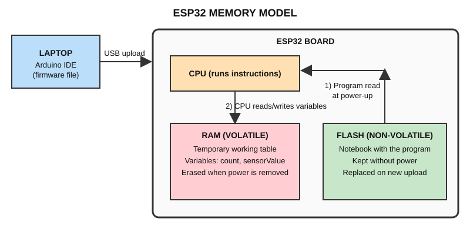

# Chapter 4 — Memory Basics

## 4.1 What is memory?

**Memory** is where a computer keeps **programs** and **data**. Without memory the CPU would have nothing to run and nowhere to keep results.

## 4.2 Primary memory vs secondary storage

| | Primary memory | Secondary storage |
|---|---|---|
| Speed | Fast | Slower |
| Connected to | CPU directly | Accessed through the system |
| Size | Smaller | Larger |
| Examples | RAM, ROM | Hard disk, SSD, SD card, USB drive |

On the ESP32, the **on-chip RAM** is primary memory. The **Flash memory** stores the program (and can be used a bit like storage). An SD card would be optional secondary storage.

## 4.3 Volatile vs non-volatile

- **Volatile** memory **loses** its contents when power is removed. → **RAM**
- **Non-volatile** memory **keeps** its contents without power. → **ROM, Flash**

## 4.4 RAM, ROM and Flash

| Type | Meaning | Volatile? | Use |
|---|---|---|---|
| **RAM** | Random Access Memory | Yes | Temporary variables and working data while the program runs |
| **ROM** | Read-Only Memory | No | Permanent code that normally cannot be changed (e.g. the ESP32's built-in boot code) |
| **Flash** | Electrically erasable, rewritable memory | No | Stores your program; can be erased and rewritten many times |

## 4.5 Analogy

> **RAM = a temporary working table.** You spread papers on it while working. When you leave, the table is cleared.
> **Flash = a notebook containing the program.** It stays even when you go home.

## 4.6 Memory diagram

## 4.7 Where things live in the ESP32

| Question | Answer |
|---|---|
| Where is my program stored? | In **Flash** memory (on ESP32 boards, a Flash chip inside the ESP32 module) |
| Where do variables live while running? | In **RAM** |
| What happens to RAM when power is removed? | It is **erased** – all variable values are lost |
| What happens to the program when power is removed? | **Nothing** – it stays in Flash and runs again at next power-up |
| What happens when I upload a new program? | The old program in Flash is **erased and replaced** by the new one; the board then restarts |

Typical sizes (vary by board): about **520 KB** internal RAM and **4 MB** external Flash on common ESP32-WROOM-32 boards.

## 4.8 Demonstration for the workshop

1. Upload a program that counts `1, 2, 3 …` in the Serial Monitor. The count variable is in **RAM**.
2. Press the **EN** (reset) button: the count restarts from 1 → RAM was cleared, but the program **still runs** → it was in **Flash**.

(The counter program is in [Level 1 exercises](../06_Exercises/Level_1_Basics.md).)

## 4.9 Check yourself

1. Which memory is volatile?
2. If you unplug the ESP32 and plug it in later, does it still remember the last uploaded program? Why?
3. Where is the variable `int count = 0;` stored while running?

---
Previous: [Chapter 3](microprocessor_vs_microcontroller.md) · Next: [ESP32 Introduction](../02_ESP32/esp32_intro.md)
