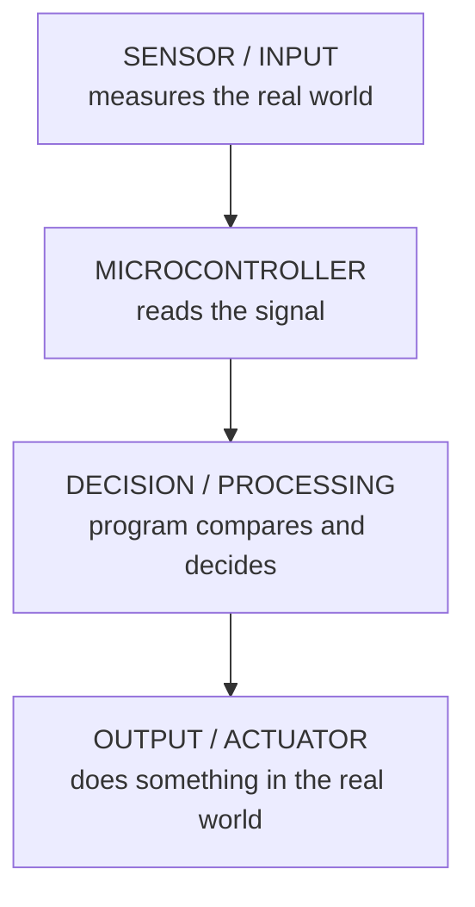
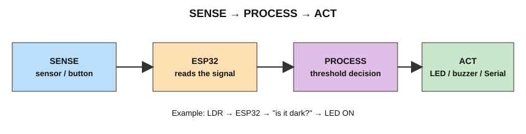

# Chapter 2 — Embedded Systems and Microcontrollers

> **In this chapter:** embedded system · microcontroller · why we use them · everyday examples · the SENSE → PROCESS → ACT model

---

## 2.1 What is an embedded system?

An **embedded system** is a specialized computer system combining hardware and software designed to perform a dedicated, **specific function** within a larger mechanical or electronic device

| General-purpose computer | Embedded system |
|---|---|
| Laptop, PC | Washing machine controller |
| Runs many different programs | Runs one dedicated program |
| Has screen, keyboard, OS | Often has buttons, sensors, LEDs |
| Costs more, uses more power | Cheap, low power |

## 2.2 What is a microcontroller?

A **microcontroller (MCU)** is a **complete tiny computer on a single chip**. Inside one chip you get:

- **CPU** – the brain that runs instructions
- **RAM** – temporary working memory
- **Flash** – permanent storage for the program
- **GPIO pins** – pins that connect to the outside world
- **Peripherals** – built-in helpers such as ADC, PWM, UART, I2C, SPI (explained in later chapters)

The **ESP32** is a microcontroller (with Wi-Fi and Bluetooth added).

## 2.3 What is a microprocessor?

A **microprocessor (MPU)** is *only the CPU* on a chip. To make a working computer you must add **separate** RAM, storage and input/output chips around it. Your laptop's Intel/AMD/ARM processor is a microprocessor-class device. More details in [Microprocessor vs Microcontroller](microprocessor_vs_microcontroller.md).

## 2.4 Why do products use microcontrollers?

- **Low cost** – a few dollars or less.
- **Low power** – can run from a small battery.
- **Small size** – everything in one chip.
- **Reliable** – does one job over and over.
- **Flexible** – change behaviour by changing the program, not the wiring.
- **Real-time control** – can react to a sensor within milliseconds.

## 2.5 Everyday embedded systems

| Product | Sensor / input | Microcontroller decides | Output / actuator |
|---|---|---|---|
| Washing machine | water level, door switch, buttons | which cycle step is next | motor, water valve, buzzer |
| Microwave oven | keypad, door switch | timer and power level | magnetron, display, beeper |
| Automatic street light | light sensor (LDR) | is it dark? | lamp ON/OFF |
| Traffic signal | timer, sometimes vehicle sensor | which lane gets green | red/yellow/green lamps |
| Air conditioner | room temperature sensor, remote | is room warmer than set value? | compressor, fan |
| Printer | paper sensor, buttons | move head, feed paper | motors, heater, display |
| Smart door lock | keypad, fingerprint, card reader | is the code correct? | lock motor, buzzer |
| Car systems | speed, engine, seat-belt sensors | warn or adjust | warning light, fuel injector, airbag |

## 2.6 The basic embedded-system model

Almost every embedded system follows the same three steps. In this handbook we call them **SENSE → PROCESS → ACT**.

Real-life examples:

| Device | SENSE | PROCESS | ACT |
|---|---|---|---|
| Street light | LDR sees darkness | "light value below threshold?" | lamp ON |
| Room fan | temperature sensor reads 32 °C | "above 30 °C?" | fan ON |
| Parking sensor | ultrasonic measures 20 cm | "closer than 30 cm?" | buzzer beeps |
| Smoke alarm | smoke sensor detects smoke | "reading above limit?" | alarm sounds |

## 2.7 Check yourself

1. Name three embedded systems in your home.
2. For each, write the SENSE, PROCESS and ACT parts.
3. Why is a microcontroller better than a laptop for controlling a street light?

---
Previous: [Chapter 1](software_program_ide.md) · Next: [Chapter 3 — Microprocessor vs Microcontroller](microprocessor_vs_microcontroller.md)
