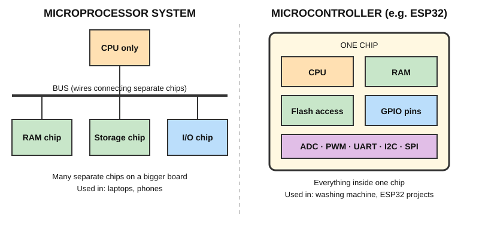

# Chapter 3 — Microprocessor vs Microcontroller

## 3.1 The picture

- **Microprocessor:** CPU alone on the chip. RAM, storage and I/O are **separate chips** on a bigger board connected by wires called a **bus**.
- **Microcontroller:** CPU + RAM + Flash + GPIO + peripherals **all inside one chip**.

## 3.2 Comparison table

| Feature | Microprocessor | Microcontroller |
|---|---|---|
| Contains | CPU only | CPU + RAM + Flash + I/O + peripherals |
| External chips needed | Yes (RAM, storage, I/O) | Usually few or none |
| Typical use | Laptops, phones, servers | Appliances, sensors, toys, cars |
| Runs | A full OS and many programs | One dedicated program |
| Speed | Very high (GHz) | Lower (MHz range; ESP32 up to 240 MHz) |
| Power | High | Low |
| Cost/system | Higher | Lower |
| Example | Intel Core, ARM Cortex-A | **ESP32**, Arduino Uno chip, STM32 |

## 3.3 Analogy

- A **microprocessor** is like a **chef only**: you still need to bring the kitchen, ingredients and utensils.
- A **microcontroller** is like a **food truck**: chef, stove and ingredients are all in one small unit doing a fixed menu.

## 3.4 Which do we use in this course?

A **microcontroller (ESP32)**, because we want to connect sensors and LEDs directly to its pins with almost no extra hardware.

## 3.5 Check yourself

1. Which one needs external RAM chips?
2. Why do washing machines use microcontrollers, not microprocessors?
3. Is the ESP32 a microprocessor or a microcontroller? Give two reasons.

---
Previous: [Chapter 2](microcontroller.md) · Next: [Chapter 4 — Memory](memory.md)
