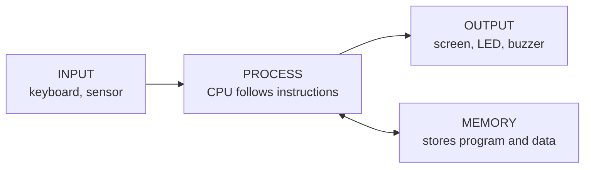
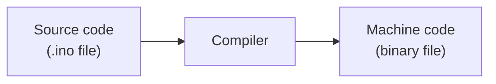

# Chapter 1 — Computer, Software, Program, IDE and Compiler

> **In this chapter:** computer · hardware · software · program · instruction · operating system · IDE · compiler · firmware
> **Time:** about 40 minutes reading + discussion

---

## 1.1 What is a computer?

**WHAT?** A computer is a machine that (1) accepts **input**, (2) **processes** it by following instructions, (3) produces **output**, and (4) can **store** data.

**WHY does this matter?** Your laptop, your phone, and the tiny ESP32 board are all computers. They differ in size, speed and purpose, but all of them follow the same idea:



## 1.2 Hardware

**Hardware** is every physical part you can touch: the chip, the wires, the LED, the sensor, the USB cable, the board.

Example: In an ESP32 project the hardware is the ESP32 board, resistor, LED and breadboard.

## 1.3 Software

**Software** is the set of instructions that tells hardware what to do. You cannot touch software. Hardware without software does nothing; software without hardware has nothing to run on.

## 1.4 Instruction and program

- An **instruction** is one tiny command the CPU understands, for example *"add these two numbers"* or *"turn this pin ON"*.
- A **program** is a list of instructions arranged in order to solve a problem.

Real-life analogy: a **recipe**. Each line ("add salt") is an instruction. The full recipe is the program. The cook is the CPU.

Example program in plain English:

```
1. Read the light level.
2. If it is dark, turn the lamp ON.
3. Otherwise, turn the lamp OFF.
4. Go back to step 1.
```

We later write this same idea in the Arduino language (C/C++).

## 1.5 Operating system (OS)

An **operating system** is a large program that manages the computer for you: it runs other programs, manages memory and files, and talks to the keyboard, screen and USB. Windows, Android and Linux are operating systems.

Your **laptop** has an OS. A basic **ESP32 Arduino program usually runs without a desktop-style OS**: your program *is* essentially the main thing running. (Internally the ESP32 Arduino core uses a small real-time system called FreeRTOS, but you do not need to know about it as a beginner.)

## 1.6 Programming language, source code and compiler

- **Source code** is the text you write (for example `digitalWrite(26, HIGH);`). Humans can read it.
- A CPU only understands **machine code**: long patterns of 0s and 1s.
- A **compiler** is a program that **translates** source code into machine code.

Analogy: you write a letter in English; a translator converts it into the language the receiver understands.



If you make a spelling/grammar mistake in code, the compiler stops and shows a **compile error**. Read the message; it usually names the line.

## 1.7 IDE

**IDE** stands for **Integrated Development Environment**. It is one application that bundles everything needed to build programs:

| Part of the IDE | What it does |
|---|---|
| Editor | where you type code |
| Compiler | translates code |
| Uploader | sends the result to the board |
| Serial Monitor | shows messages sent by the board |

We use **Arduino IDE**.

## 1.8 Firmware

**Firmware** is the program stored **permanently inside a device's memory** so that the device knows what to do the moment it is powered on.

- When you compile and upload your Arduino code to the ESP32, the result **is** the ESP32's firmware.
- Examples: the program inside a washing machine, remote control or microwave.

**Software vs firmware:** both are programs. The word *firmware* is used when the program lives inside a hardware device and is tightly tied to it.

## 1.9 Summary table

| Term | One-line meaning |
|---|---|
| Computer | Machine that takes input, processes it, gives output |
| Hardware | Physical parts |
| Software | Instructions/programs |
| Instruction | One small command for the CPU |
| Program | Ordered list of instructions |
| OS | Program that manages a computer and runs other programs |
| Compiler | Translates source code to machine code |
| IDE | Editor + compiler + uploader + Serial Monitor in one tool |
| Firmware | Program stored inside a device |

## 1.10 Check yourself

1. Give two examples each of hardware and software in an ESP32 project.
2. Why can the CPU not run your `.ino` text directly?
3. Is the program inside a microwave software or firmware? (Trick: it can be called both — explain why.)

---
Next: [Chapter 2 — Microcontroller and Embedded Systems](microcontroller.md)
