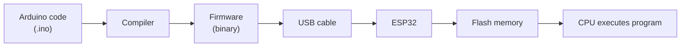
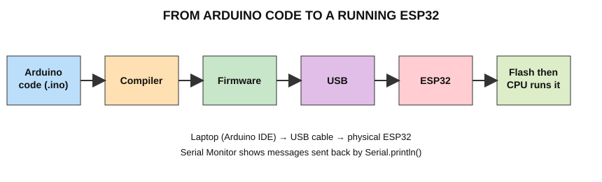

# Chapter 8 — Installing Arduino IDE and Preparing the ESP32

> Menu names can change slightly between versions. If something looks different, use the official documentation:
> - Arduino IDE download: https://www.arduino.cc/en/software
> - ESP32 Arduino installation guide (Espressif): https://docs.espressif.com/projects/arduino-esp32/en/latest/installing.html
> - USB driver CP210x (Silicon Labs): https://www.silabs.com/developers/usb-to-uart-bridge-vcp-drivers
> - USB driver CH340 (WCH): search "CH340 driver" on the manufacturer's site https://www.wch-ic.com

## 8.1 Workflow diagram





**What happens internally when you press Upload**
1. The IDE **compiles** your code into machine code (firmware).
2. The IDE opens the **COM port** and puts the ESP32 in download mode.
3. The firmware is sent through **USB → USB-serial chip → UART** to the ESP32.
4. The ESP32 writes it into **Flash**.
5. The ESP32 **restarts**; the CPU starts executing your `setup()` then `loop()`.

## 8.2 Step 1 — Download Arduino IDE
1. Open https://www.arduino.cc/en/software
2. Download **Arduino IDE 2.x for Windows**.

## 8.3 Step 2 — Install on Windows
1. Run the installer. Accept the licence and default options.
2. Allow driver prompts if Windows asks.
3. Finish the installation.

## 8.4 Step 3 — Open Arduino IDE
Start Arduino IDE from the Start menu. You will see an editor with an empty sketch containing `setup()` and `loop()`.

## 8.5 Step 4 — Install ESP32 board support
Method A (recommended, uses the Boards Manager URL):
1. Go to **File → Preferences**.
2. In **Additional boards manager URLs** paste:
   ```
   https://espressif.github.io/arduino-esp32/package_esp32_index.json
   ```
3. Click **OK**.
4. Open **Tools → Board → Boards Manager…** (or click the board icon on the left).
5. Search **esp32**.
6. Install **"esp32" by Espressif Systems**. It downloads a large package; wait for "installed".

> Always confirm the current URL/steps in Espressif's official installation guide linked above.

## 8.6 Step 5 — Connect the ESP32
1. Use a **data** USB cable (many cheap cables only charge).
2. Connect ESP32 to laptop. A power LED on the board should light.
3. Open **Device Manager → Ports (COM & LPT)**. You should see an entry such as `Silicon Labs CP210x … (COM5)` or `USB-SERIAL CH340 (COM5)`.
4. If no port appears, install the driver for your USB chip (links above), try another cable/port.

## 8.7 Step 6 — Select the board
**Tools → Board → esp32 → ESP32 Dev Module**
(If your board has a specific name in the list, you may choose that.)

## 8.8 Step 7 — Select the COM port
**Tools → Port →** choose the COM port that appeared when you plugged in the board.

## 8.9 Step 8 — Upload a program
1. Open **File → New Sketch** and type the "Hello ESP32" program from the next chapter.
2. Click **Verify** (✓) to compile.
3. Click **Upload** (→).
4. Watch the bottom panel: `Connecting…` then percentages, then `Hard resetting via RTS pin…` = success.
5. If it stays at `Connecting…`: hold the **BOOT** button on the board until upload starts, then release.

## 8.10 Step 9 — Open the Serial Monitor
1. Click the magnifier icon (top-right) or **Tools → Serial Monitor**.
2. Set baud rate to **115200** (bottom-right dropdown). It **must match** `Serial.begin(115200);` in the code.
3. If you see nothing, press the **EN** button on the board.

## 8.11 Setup checklist
- [ ] Arduino IDE installed
- [ ] ESP32 board package installed
- [ ] Data cable connected, COM port visible
- [ ] Board = ESP32 Dev Module
- [ ] Port selected
- [ ] Sketch uploaded without error
- [ ] Serial Monitor at 115200 baud

---
Previous: [Pin reference](pin_reference.md) · Next: [Hello ESP32 — first program](../03_Basic_Experiments/Hello_ESP32/README.md)
