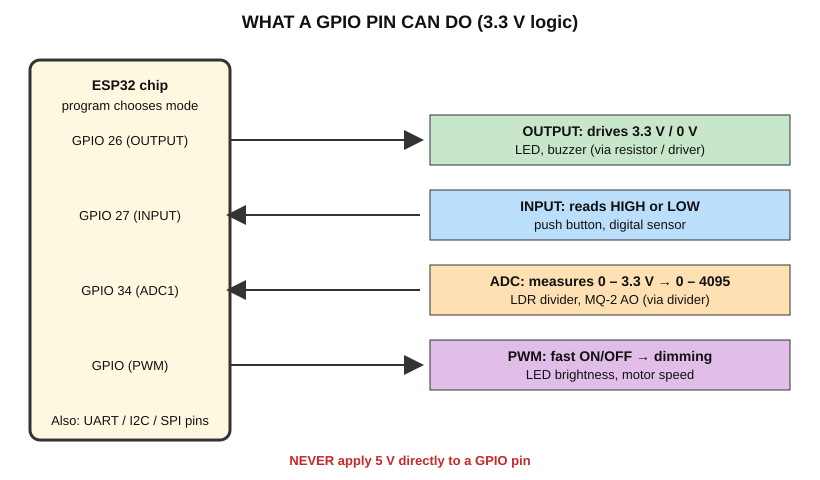

# Chapter 6 — GPIO: The Pins That Touch the Real World

## 6.1 What does a GPIO pin actually do?

A **GPIO (General-Purpose Input/Output)** pin is a metal pin connected to the chip. Inside the chip, your program can decide what the pin does:

- **As OUTPUT:** the ESP32 **drives** the pin to 3.3 V (HIGH) or 0 V (LOW). This can turn an LED on or off.
- **As INPUT:** the ESP32 **listens** to the pin voltage and reports whether it is HIGH or LOW. This can read a button.
- **As ADC input:** the ESP32 **measures** the voltage as a number 0–4095.
- **As PWM output:** the ESP32 **switches the pin ON/OFF quickly** to fake in-between voltages.
- **As communication pin:** the pin carries UART / I2C / SPI data.



## 6.2 Mode by mode

### GPIO as OUTPUT
```cpp
pinMode(26, OUTPUT);
digitalWrite(26, HIGH);   // pin = 3.3 V
digitalWrite(26, LOW);    // pin = 0 V
```
**Physically:** an internal switch connects the pin to 3.3 V or to GND. **Used for:** LED, buzzer (small), transistor driver.

### GPIO as INPUT
```cpp
pinMode(27, INPUT_PULLUP);
int state = digitalRead(27);   // HIGH or LOW
```
**Physically:** the pin senses the voltage. Above a threshold → HIGH, below → LOW. **Used for:** buttons, digital sensors.

> A pin left unconnected (**floating**) picks up noise and reads randomly. That is why we use a **pull-up resistor** (explained in the Push Button chapter).

### ADC input
```cpp
int value = analogRead(34);    // 0 to 4095
```
**Physically:** the voltage is converted to a number. **Used for:** LDR, MQ-2 analog output.

Rules for ADC on this handbook's board:
- Use **ADC1 pins** (GPIO 32–39). ADC2 pins cannot be used while Wi-Fi is on.
- Keep input voltage **≤ 3.3 V**.
- ADC readings are **not perfectly linear** and are noisy; do not treat them as lab-grade voltmeters.

### PWM output
```cpp
ledcAttach(26, 5000, 8);   // pin, frequency (Hz), resolution (bits)  – ESP32 Arduino core 3.x
ledcWrite(26, 128);        // about 50 % brightness
```
> The PWM function names changed between core versions 2.x and 3.x. Check your installed core version before using PWM. Beginner experiments in this handbook do not require PWM.

### Communication pins
- **UART:** TX/RX. GPIO1/GPIO3 are used by the USB Serial Monitor – **do not use them for sensors**.
- **I2C:** default SDA = GPIO21, SCL = GPIO22 on most ESP32 DevKit boards.
- **SPI:** default pins (GPIO 18, 19, 23, 5) on most boards.

Because we want to keep things simple, several handbook sensors use GPIO 21/22 as **ordinary** pins (TCS3200 select lines). This is fine because we do not use I2C in those experiments.

## 6.3 Pin rules every beginner must know

| Rule | Reason |
|---|---|
| Logic level is **3.3 V** | 5 V can damage the pin |
| Never use **GPIO 6–11** | Connected to the on-board Flash |
| **GPIO 34, 35, 36, 39 are input-only** | Cannot drive outputs, and have **no internal pull-up/pull-down** |
| Avoid **strapping pins** (0, 2, 5, 12, 15) for beginner circuits | They set boot behaviour; wrong external levels at power-up can stop upload/boot |
| Avoid **GPIO 1, 3** | Used for USB serial |
| Use **ADC1** (32–39) for analog | ADC2 conflicts with Wi-Fi |
| Max current per pin is small (a few mA – tens of mA) | Use resistors; use transistors for big loads |

## 6.4 Where is it used?

Turning on lamps, reading switches, measuring sensors, driving buzzers, talking to displays.

## 6.5 Check yourself

1. Which function chooses whether a pin is input or output?
2. Why can GPIO 34 not light an LED directly?
3. What number does `analogRead()` return for about 1.65 V (half of 3.3 V)? (About 2048, but not exactly.)

---
Previous: [ESP32 intro](esp32_intro.md) · Next: [Pin reference](pin_reference.md)
