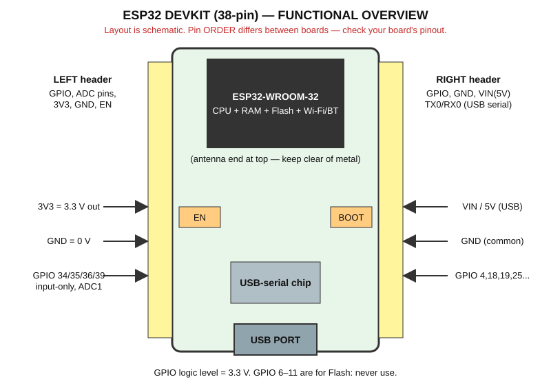

# Chapter 7 — ESP32 Board and Pin Reference

> ⚠️ **Check your exact board.** ESP32 development boards from different makers look similar but differ in pin order, silkscreen labels, USB connector and USB chip. **Always compare with your own board's pinout diagram.** This handbook assumes an **ESP32 DevKit, 38-pin, ESP32-WROOM-32**. The 30-pin version has the same GPIOs we use, but may lack a few pins.

## 7.1 Board overview

## 7.2 Board parts explained

| Part | What it is | Beginner note |
|---|---|---|
| **USB port** | Power + programming + Serial Monitor | Use a **data** cable |
| **USB-serial chip** | CP2102 or CH340 – translates USB ↔ UART | Windows may need a driver |
| **ESP32 module** | The metal-shielded module with the ESP32 chip and Flash | Antenna at the end – keep it away from metal |
| **EN (RESET) button** | Restarts the program | Program is **not** erased |
| **BOOT button** | Connected to GPIO0; used for upload mode | Some boards need it held during upload |
| **VIN / 5V** | About 5 V from USB (or input if externally powered) | Power for HC-SR04, MQ-2 |
| **3V3** | 3.3 V output from the regulator | Power for 3.3 V sensors; small current |
| **GND** | Ground (0 V) | Several GND pins; **all connected together** |
| **GPIO pins** | Programmable pins | Labelled `Dxx`, `GPIOxx` or just `xx` |

**Power pin naming:** some boards label the 5 V pin `VIN`, others `5V`. Identify it by voltage (measure with a multimeter if unsure), not just by name. Never feed more than 5 V into `VIN`.

## 7.3 Beginner pin-reference table

| GPIO | Safe for beginners? | Can be input | Can be output | ADC | Notes |
|---|---|---|---|---|---|
| 0 | ⚠️ Avoid | Yes | Yes | ADC2 | BOOT button, strapping pin |
| 1 (TX0) | ❌ Avoid | – | – | – | USB serial TX |
| 2 | ⚠️ Avoid | Yes | Yes | ADC2 | Strapping pin; on-board LED on some boards |
| 3 (RX0) | ❌ Avoid | – | – | – | USB serial RX |
| 4 | ✅ Yes | Yes | Yes | ADC2 | Used for DHT11 in this handbook |
| 5 | ⚠️ Careful | Yes | Yes | – | Strapping pin |
| 6–11 | ❌ Never | – | – | – | Connected to Flash |
| 12 | ⚠️ Avoid | Yes | Yes | ADC2 | Strapping pin (Flash voltage) |
| 13, 14 | ✅ Yes | Yes | Yes | ADC2 | General use |
| 15 | ⚠️ Avoid | Yes | Yes | ADC2 | Strapping pin |
| 16, 17 | ✅ Yes | Yes | Yes | – | TCS3200 S0/S1 |
| 18, 19 | ✅ Yes | Yes | Yes | – | HC-SR04 TRIG/ECHO |
| 21, 22 | ✅ Yes | Yes | Yes | – | I2C by default; used as normal pins for TCS3200 S2/S3 |
| 23 | ✅ Yes | Yes | Yes | – | TCS3200 OUT |
| 25 | ✅ Yes | Yes | Yes | ADC2 | Buzzer in this handbook |
| 26 | ✅ Yes | Yes | Yes | ADC2 | LED in this handbook |
| 27 | ✅ Yes | Yes | Yes | ADC2 | Push button in this handbook |
| 32, 33 | ✅ Yes | Yes | Yes | **ADC1** | 32 = flame DO, 33 = flame AO |
| 34 | ✅ Yes | Yes | ❌ | **ADC1** | **Input only**, no pull-up. LDR |
| 35 | ✅ Yes | Yes | ❌ | **ADC1** | **Input only**, no pull-up. MQ-2 AO (via divider) |
| 36 (VP), 39 (VN) | ✅ Yes | Yes | ❌ | **ADC1** | Input only, no pull-up |

Pins 34/35/36/39 lack internal pull-ups, so external resistors are needed for buttons.

## 7.4 Handbook pin map (used in every diagram and sketch)

| Item | GPIO |
|---|---|
| LED (+220 Ω) | 26 |
| Push button | 27 |
| Active buzzer | 25 |
| LDR divider midpoint | 34 |
| MQ-2 AO (through divider) | 35 |
| HC-SR04 TRIG / ECHO | 18 / 19 |
| DHT11 DATA | 4 |
| Flame sensor DO | 32 |
| TCS3200 S0 / S1 / S2 / S3 / OUT | 16 / 17 / 21 / 22 / 23 |

### If your board is different
1. Find the exact pinout diagram from the seller/manufacturer.
2. Check that each GPIO above exists on your board and is not tied to something else.
3. If not, pick another safe GPIO from the table and **change it in the code and wiring**.

---
Previous: [GPIO](gpio.md) · Next: [Arduino IDE setup](arduino_ide_setup.md)
