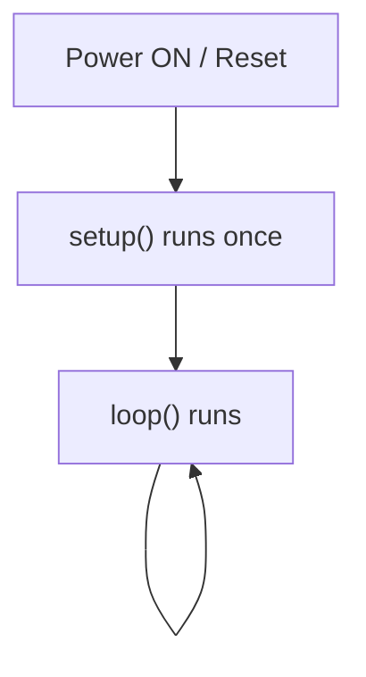

# Hello ESP32 — Your First Program

> **Goal:** upload a program to the physical ESP32 and see its message in the Serial Monitor.
> **You need:** ESP32 + USB data cable + Arduino IDE set up ([setup guide](../../02_ESP32/arduino_ide_setup.md)). No other components.

## Step 1 — The empty program

Every Arduino/ESP32 program has two required functions. This is the smallest valid program:

```cpp
void setup()
{
}

void loop()
{
}
```

**What is a function?** A named block of instructions. `void` means "this function does not give back a value". The curly brackets `{ }` hold the instructions.

### What `setup()` does
- Runs **exactly once**, when the ESP32 powers up or is reset.
- Used for preparation: starting Serial, choosing pin modes.

### What `loop()` does
- Runs **again and again, forever**, after `setup()` finishes.
- Used for the real work: read → decide → act.

### Why does `loop()` repeat?
A microcontroller has no "end". Unlike a laptop program, it should keep working as long as it has power (a street light must keep checking the light all night). The Arduino framework calls `loop()` over and over for this reason.



## Step 2 — Hello ESP32

```cpp
// Hello_ESP32 - prints a message once per second to the Serial Monitor.

void setup()
{
  Serial.begin(115200);   // Start serial communication at 115200 bits per second
}

void loop()
{
  Serial.println("Hello ESP32");   // Send text followed by a new line
  delay(1000);                     // Wait 1000 milliseconds (1 second)
}
```

### Line-by-line explanation

| Code | Meaning |
|---|---|
| `// comment` | Notes for humans; ignored by the compiler |
| `void setup()` | Function that runs once at start |
| `Serial.begin(115200);` | Starts UART communication with the laptop at **115200 baud** (bits per second). The Serial Monitor must use the same number |
| `void loop()` | Function that repeats forever |
| `Serial.println("Hello ESP32");` | Sends the text, then a new line. `print` = no new line, `println` = with new line |
| `delay(1000);` | Pauses the program for 1000 milliseconds (1 s) |
| `;` | Ends every statement |

## Expected Serial Monitor output (baud rate 115200)

```
Hello ESP32
Hello ESP32
Hello ESP32
...
```
One line per second. (When you press EN you may also see a few lines of boot messages first; that is normal.)

## What is happening?

| Question | Answer |
|---|---|
| **What is happening physically?** | The CPU sends bytes to the UART peripheral, which sends voltage pulses on the TX line to the USB-serial chip. |
| **What signal is generated?** | A digital serial signal (UART), converted by the USB chip into USB data. |
| **How does the laptop receive it?** | Through the USB cable, as a COM port that the Serial Monitor reads. |
| **What does the program do?** | Prints text every second. |
| **What output do we get?** | Text lines in the Serial Monitor. |

## Troubleshooting
- **Garbage characters** → baud rate in Serial Monitor is not 115200.
- **Nothing appears** → press the EN button; check the correct COM port.
- **Upload fails** → hold BOOT while "Connecting…" is shown. See [Troubleshooting](../../docs/Troubleshooting.md).

## Exercise
1. Change the message to your name.
2. Change the delay to 500 ms. What changes?
3. Replace `println` with `print`. What changes in the output?

Next: [LED Experiments](../LED_Blink/README.md)
