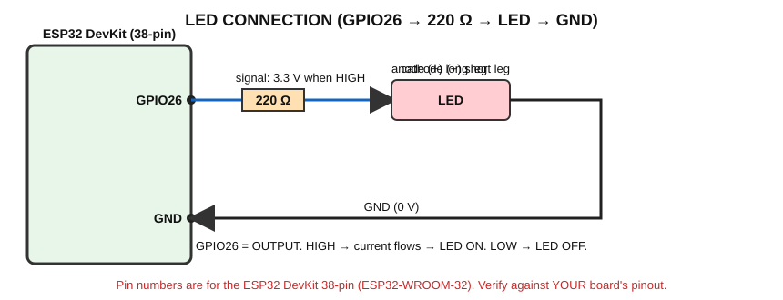

# LED Experiments — ON/OFF, Blinking, Patterns

> **Goal:** control a real LED with a GPIO pin (your first ACT).
> **You need:** ESP32, breadboard, 1 LED, 1 × 220 Ω resistor, 2 jumper wires.

## What is an LED?
An **LED (Light Emitting Diode)** is a component that gives light when current flows through it in **one direction only**.
- **Anode (+)**: the **longer leg**.
- **Cathode (−)**: the **shorter leg** / flat side of the plastic body.

## Why is a resistor required?
An LED has very little resistance once it turns on. Without a resistor, too much current would flow and damage the LED and/or the GPIO pin. The resistor **limits the current**.

Approximate current: `I = (3.3 V − LED voltage drop) / R`. For a red LED (about 2 V drop) and 220 Ω: I ≈ (3.3 − 2.0) / 220 ≈ **6 mA** – safe and clearly visible. (Blue/white LEDs drop about 3 V, so they will look dimmer at 3.3 V; that is normal.)

## Circuit

```
ESP32 GPIO26 → 220 Ω resistor → LED anode (+) … LED cathode (−) → GND
```



| From | To |
|---|---|
| ESP32 GPIO26 | one leg of 220 Ω resistor |
| other leg of resistor | LED **anode (long leg)** |
| LED **cathode (short leg)** | ESP32 GND |

⚠️ Disconnect USB while wiring. Confirm GPIO26 exists on your board.

## Functions used
| Function | Meaning |
|---|---|
| `pinMode(pin, OUTPUT)` | Tells the ESP32 to use this pin as an **output** (it will drive the voltage) |
| `digitalWrite(pin, HIGH)` | Sets the pin to **3.3 V** |
| `digitalWrite(pin, LOW)` | Sets the pin to **0 V** |
| `HIGH` / `LOW` | Constants meaning 3.3 V / 0 V (logic 1 / logic 0) |
| `delay(ms)` | Waits for the given milliseconds (1000 ms = 1 s) |

## Experiment 1 — LED ON / OFF

```cpp
// Experiment 1 - LED ON / OFF
// Wiring: GPIO26 -> 220 ohm resistor -> LED anode (+); LED cathode (-) -> GND

const int LED_PIN = 26;      // The GPIO pin connected to the LED

void setup()
{
  pinMode(LED_PIN, OUTPUT);      // Make the pin an OUTPUT
  digitalWrite(LED_PIN, HIGH);   // HIGH = 3.3 V -> LED ON
  // Change HIGH to LOW, upload again, and the LED will stay OFF.
}

void loop()
{
  // Nothing to repeat in this experiment.
}
```

**Explanation:** `const int LED_PIN = 26;` gives the pin a readable name (`const` = value never changes). `pinMode` sets it as an output in `setup()`. `digitalWrite(LED_PIN, HIGH)` puts 3.3 V on the pin → current flows through resistor and LED → LED lights. `loop()` is empty because nothing needs repeating.

**Try:** change `HIGH` to `LOW`, upload again → LED stays off.

## Experiment 2 — LED blinking

```cpp
// Experiment 2 - LED blinking
// Wiring: GPIO26 -> 220 ohm resistor -> LED anode (+); LED cathode (-) -> GND

const int LED_PIN = 26;

void setup()
{
  Serial.begin(115200);
  pinMode(LED_PIN, OUTPUT);
}

void loop()
{
  digitalWrite(LED_PIN, HIGH);   // LED ON
  Serial.println("LED ON");
  delay(1000);                   // Stay ON for 1 second

  digitalWrite(LED_PIN, LOW);    // LED OFF
  Serial.println("LED OFF");
  delay(1000);                   // Stay OFF for 1 second
}
```

**Explanation:** in `loop()` the pin is set HIGH (ON), the program waits 1 s, sets LOW (OFF), waits 1 s, then `loop()` repeats → continuous blinking. `Serial.println` prints the status so you can see what the program is doing.

**Expected output:**
```
LED ON
LED OFF
LED ON
LED OFF
```

## Experiment 3 — Different blink patterns

```cpp
// Experiment 3 - Different blink patterns
// Wiring: GPIO26 -> 220 ohm resistor -> LED anode (+); LED cathode (-) -> GND

const int LED_PIN = 26;

// Blink the LED "times" times. Each blink is ON for onMs and OFF for offMs.
void blinkLed(int times, int onMs, int offMs)
{
  for (int i = 0; i < times; i++)
  {
    digitalWrite(LED_PIN, HIGH);
    delay(onMs);
    digitalWrite(LED_PIN, LOW);
    delay(offMs);
  }
}

void setup()
{
  Serial.begin(115200);
  pinMode(LED_PIN, OUTPUT);
}

void loop()
{
  Serial.println("Pattern 1: fast blink");
  blinkLed(5, 100, 100);
  delay(1000);

  Serial.println("Pattern 2: heartbeat (two quick blinks)");
  blinkLed(2, 150, 150);
  delay(1000);

  Serial.println("Pattern 3: SOS (... --- ...)");
  blinkLed(3, 200, 200);    // three short
  blinkLed(3, 600, 200);    // three long
  blinkLed(3, 200, 200);    // three short
  delay(2000);
}
```

**Explanation of the new parts:**
- `void blinkLed(int times, int onMs, int offMs)` is **your own function**. It repeats an ON/OFF blink `times` times. `int times` etc. are **parameters**: values you give when calling it.
- `for (int i = 0; i < times; i++)` is a **loop that counts**: starts with `i = 0`, repeats while `i < times`, adds 1 to `i` after each round.
- `blinkLed(5, 100, 100);` means 5 blinks, 100 ms ON, 100 ms OFF.
- SOS in Morse code = three short, three long, three short.

## What is happening?

| Question | Answer |
|---|---|
| **Physically** | The GPIO driver connects the pin to 3.3 V or 0 V. With 3.3 V on the pin, current flows through resistor and LED to GND; the LED emits light. |
| **Signal generated** | A digital output signal: HIGH (3.3 V) / LOW (0 V). |
| **How ESP32 sends it** | CPU writes to the GPIO output register; the pin driver switches. |
| **What the program does** | Chooses when to set HIGH and LOW and how long to wait. |
| **Output** | Visible LED behaviour + Serial messages. |

## Where is it used?
Status lights on routers, chargers, appliances, and every warning lamp in later projects.

## Troubleshooting
| Problem | Check |
|---|---|
| LED never lights | LED reversed (swap legs); wrong GPIO; resistor not connected; loose breadboard wire |
| LED always on | Wire touching 3V3; sketch sets HIGH only |
| Very dim LED | Blue/white LED at 3.3 V or resistor too large |

## Student exercises
1. Make the LED ON for 200 ms and OFF for 800 ms.
2. Create your own pattern (e.g. 1 long + 2 short).
3. Add a second LED on GPIO25 and alternate the two LEDs.

Next: [Push Button](../Push_Button/README.md)
