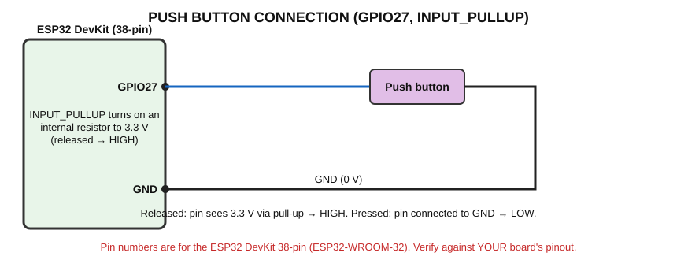

# Push Button — Your First INPUT

> **Goal:** read a button with the ESP32, then make the button control an LED.
> **You need:** ESP32, breadboard, push button, LED + 220 Ω resistor (from the previous experiment), jumper wires.

## Terms first
- **Digital input:** the ESP32 checks whether a pin voltage is high or low.
- **HIGH** = about 3.3 V (logic 1). **LOW** = about 0 V (logic 0).
- **Floating pin:** an input connected to nothing. It picks up noise and gives random readings. Never leave an input floating.
- **Pull-up resistor:** a resistor that connects an input pin to 3.3 V so that it reads HIGH when nothing else drives it.
- **`INPUT_PULLUP`:** a mode where the ESP32 turns on its **own internal pull-up resistor** for that pin (no external resistor needed).

Note: GPIO 34–39 have **no** internal pull-ups; that is why we use GPIO27.

## Circuit



| From | To |
|---|---|
| Button leg 1 | ESP32 GPIO27 |
| Button leg 2 | ESP32 GND |

(Four-leg buttons: legs on the **same side** are connected internally; use two legs that are on **opposite** sides.)

## Why the logic is "inverted"
```
Released:  3.3 V ── pull-up ──●── GPIO27      → reads HIGH
Pressed:   GPIO27 ── button ── GND            → reads LOW
```
- **Button released → HIGH** (pull-up resistor holds the pin at 3.3 V).
- **Button pressed → LOW** (button connects the pin directly to GND, which wins over the weak pull-up).

## Program 1 — read the button

```cpp
// Push button reading
// Wiring: one leg of the button -> GPIO27, the other leg -> GND. No external resistor needed.

const int BUTTON_PIN = 27;

void setup()
{
  Serial.begin(115200);
  pinMode(BUTTON_PIN, INPUT_PULLUP);   // Input with the internal pull-up resistor enabled
}

void loop()
{
  int buttonState = digitalRead(BUTTON_PIN);   // HIGH or LOW

  if (buttonState == LOW)
  {
    Serial.println("Button PRESSED  (pin reads LOW)");
  }
  else
  {
    Serial.println("Button RELEASED (pin reads HIGH)");
  }

  delay(200);   // Read 5 times per second so the Serial Monitor is readable
}
```

| Code | Meaning |
|---|---|
| `pinMode(BUTTON_PIN, INPUT_PULLUP);` | Pin is an input with internal pull-up on |
| `int buttonState = digitalRead(BUTTON_PIN);` | Reads HIGH (1) or LOW (0) and stores it |
| `if (buttonState == LOW)` | `==` **compares**; true when the button is pressed |
| `delay(200);` | Slows printing to 5 lines per second |

**Expected output:**
```
Button RELEASED (pin reads HIGH)
Button RELEASED (pin reads HIGH)
Button PRESSED  (pin reads LOW)
Button PRESSED  (pin reads LOW)
Button RELEASED (pin reads HIGH)
```

## Program 2 — Button → ESP32 → LED

Add the LED circuit from the previous experiment (GPIO26 → 220 Ω → LED → GND).

```cpp
// Button -> ESP32 -> LED
// Wiring: button between GPIO27 and GND; LED with 220 ohm resistor on GPIO26 (other end to GND)

const int BUTTON_PIN = 27;
const int LED_PIN = 26;

void setup()
{
  Serial.begin(115200);
  pinMode(BUTTON_PIN, INPUT_PULLUP);
  pinMode(LED_PIN, OUTPUT);
}

void loop()
{
  int buttonState = digitalRead(BUTTON_PIN);

  if (buttonState == LOW)              // Pressed
  {
    digitalWrite(LED_PIN, HIGH);       // LED ON
    Serial.println("Pressed -> LED ON");
  }
  else                                 // Released
  {
    digitalWrite(LED_PIN, LOW);        // LED OFF
    Serial.println("Released -> LED OFF");
  }

  delay(100);
}
```

### Complete signal flow
```
Finger presses button
   → GPIO27 connected to GND → pin voltage ≈ 0 V (LOW)
   → ESP32 digitalRead() returns LOW
   → program: if (LOW) then digitalWrite(26, HIGH)
   → GPIO26 outputs 3.3 V → current through resistor and LED
   → LED lights
```

## What is happening?
| Question | Answer |
|---|---|
| **Physically** | The button closes a mechanical contact between GPIO27 and GND. |
| **Signal** | Digital: 3.3 V (released) or 0 V (pressed). |
| **How ESP32 receives it** | The input buffer of the pin compares the voltage with a threshold; `digitalRead()` returns 1 or 0. |
| **Program** | Reads the state, then sets GPIO26 accordingly. |
| **Output** | LED on while pressed; Serial messages. |

## Where is it used?
Keypads, power buttons, door switches, limit switches, emergency stops.

## Troubleshooting
| Problem | Cause / fix |
|---|---|
| Always PRESSED | Button legs on same internal side (always connected); wire to GND wrong |
| Always RELEASED | Button not connected to GND; wrong GPIO |
| Random changes | Loose wire; floating pin (missing `INPUT_PULLUP`) |
| Multiple readings per press | Mechanical **bounce** – normal; add `delay(50)` after a change |

## Student exercises
1. Make the LED **turn off** while pressed (invert the logic).
2. Toggle the LED each time the button is pressed (needs a variable that remembers the state).
3. Count presses and print the count.

Next: [Sensor Basics](../../04_Sensors/00_Sensor_Basics.md)
