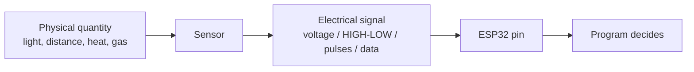

# Sensor Basics — Before We Touch Any Sensor

## What is a sensor?
A **sensor** is a device that **detects a physical quantity** from the real world (light, distance, temperature, gas, flame, colour) and **converts it into an electrical signal** that a microcontroller can read.

> Sensor = the "senses" of an embedded system. It is the **SENSE** in SENSE → PROCESS → ACT.

## The five signal types you will meet

| # | Signal type | What it looks like | Example | ESP32 method |
|---|---|---|---|---|
| 1 | **Analog voltage** | Any voltage between 0 V and 3.3 V | LDR divider, MQ-2 AO | `analogRead()` (ADC) |
| 2 | **Digital HIGH/LOW** | Only 3.3 V or 0 V | Flame DO, MQ-2 DO, button | `digitalRead()` |
| 3 | **Digital data protocol** | A stream of pulses carrying numbers | DHT11 (own 1-wire protocol) | Library + `digitalRead`-style timing |
| 4 | **Pulse width** | Length of a HIGH pulse carries information | HC-SR04 ECHO | `pulseIn()` |
| 5 | **Frequency** | Square wave; how many pulses per second carries information | TCS3200 OUT | `pulseIn()` on the wave |

### Analog vs digital (recap)
- **Analog:** continuous; the ESP32 measures it with the **ADC**, giving 0–4095.
- **Digital:** two states only.

### Voltage first!
Before wiring any sensor, ask: **What supply voltage does it need, and what voltage is its output?** ESP32 GPIOs accept **3.3 V maximum**. This decides whether you need a voltage divider.

## Sensor summary table

| Sensor | Quantity detected | Signal type | ESP32 method |
|---|---|---|---|
| LDR | Light intensity | Analog voltage (via divider) | `analogRead()` |
| HC-SR04 | Distance (via echo time) | Pulse width (ECHO) | `digitalWrite()` TRIG + `pulseIn()` ECHO |
| DHT11 | Temperature and humidity | Digital data protocol | DHT library |
| MQ-2 | Combustible gas / smoke level | Analog voltage (AO), digital HIGH/LOW (DO) | `analogRead()` / `digitalRead()` |
| Flame sensor | Infrared from flame | Digital (DO) and analog (AO) | `digitalRead()` / `analogRead()` |
| TCS3200 | Colour (R, G, B intensity) | Frequency | `pulseIn()` with filter selection |

## The standard sensor chapter layout
Each sensor chapter has the same sections **A–N**: what it detects, working principle, how the signal is generated, what reaches the ESP32, how it is read, connection diagram, pin table, code, line-by-line explanation, expected output, applications, troubleshooting, safety, exercise.

Follow the workflow in [Practical Workflow](../docs/Practical_Workflow.md): **observe raw readings first, then choose a threshold, then control an output.**

Next: [LDR](LDR/README.md)
