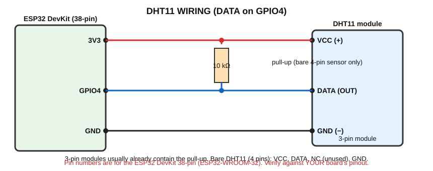

# DHT11 — Temperature and Humidity Sensor

> **Components:** ESP32, DHT11 (3-pin module or bare 4-pin sensor), 10 kΩ resistor (bare sensor), LED + 220 Ω, jumper wires.

## A. What does it detect?
**Air temperature** (°C) and **relative humidity** (%).
Typical DHT11 limits: temperature about 0–50 °C (±2 °C), humidity about 20–90 % (±5 %). It is cheap and simple, not precise.

## B. Real-world working principle
The DHT11 contains two sensing parts and a tiny chip:
- **Humidity sensor:** a moisture-absorbing material between two electrodes. As it absorbs water vapour, its electrical resistance/conductivity changes.
- **Temperature sensor:** an **NTC thermistor** (resistance decreases as temperature rises).
- **Small chip:** measures both, converts them into numbers, and sends them digitally.

## C. How does the sensor generate its electrical signal?
**The DHT11 does NOT simply output an analog voltage.** Its internal chip performs the measurement and sends the result as **digital data** over one wire (DATA).

**Digital communication:** information is sent as a sequence of HIGH/LOW pulses; the **length of each pulse** represents a 0 or a 1 bit.

How a reading happens:
1. ESP32 pulls DATA **LOW for at least 18 ms**, then releases it (start signal).
2. The DHT11 answers with a short response pulse.
3. It sends **40 bits** = humidity data (16 bits) + temperature data (16 bits) + checksum (8 bits).
4. The **checksum** lets the ESP32 detect errors.

You do **not** write this timing yourself: the Adafruit **DHT library** does it.

## D. What signal reaches the ESP32?
A **digital data signal** (3.3 V level when powered from 3V3) on GPIO4.

## E. How does the ESP32 read it?
With the library: `dht.readTemperature()` and `dht.readHumidity()`. The library does the start signal, timing measurement and checksum check.
If reading fails, the function returns `NaN` ("not a number").

## Library installation (Arduino IDE 2.x)
1. Open **Sketch → Include Library → Manage Libraries…** (or the library icon on the left).
2. Search **DHT sensor library** → install **"DHT sensor library" by Adafruit**.
3. When asked, install its dependency **Adafruit Unified Sensor**.

## F. Connection diagram


## G. Pin connection table
| DHT11 pin | Connects to |
|---|---|
| VCC / + | ESP32 **3V3** |
| DATA / OUT / S | **GPIO4** (+ **10 kΩ** from DATA to 3V3 if it's a bare sensor) |
| GND / − | ESP32 GND |
| NC (bare sensor, pin 3) | not connected |
| Warning LED | GPIO26 → 220 Ω → LED (+); LED (−) → GND |

A **3-pin module** has a small circuit board with the pull-up resistor already installed. Check the pin labels printed on the board; the order differs between makers.

## H. Arduino code

```cpp
// DHT11 room temperature monitor
// Wiring: DHT11 VCC -> 3V3, DATA -> GPIO4, GND -> GND (10 kohm pull-up DATA->3V3 if bare sensor)
//         GPIO26 -> 220 ohm -> LED -> GND (warning LED)
// Library needed: "DHT sensor library" by Adafruit (and "Adafruit Unified Sensor")

#include "DHT.h"

const int DHT_PIN = 4;
const int LED_PIN = 26;
const float TEMP_LIMIT_C = 30.0;   // LED turns ON above this temperature

DHT dht(DHT_PIN, DHT11);           // Create a DHT object for a DHT11 on GPIO4

void setup()
{
  Serial.begin(115200);
  pinMode(LED_PIN, OUTPUT);
  dht.begin();
  Serial.println("DHT11 started");
}

void loop()
{
  delay(2000);                                   // DHT11 needs time between readings

  float humidity = dht.readHumidity();           // Percent
  float temperature = dht.readTemperature();     // Degrees Celsius

  if (isnan(humidity) || isnan(temperature))     // isnan = "is not a number" -> reading failed
  {
    Serial.println("Failed to read from DHT11 - check wiring");
    return;                                      // Skip the rest and try again
  }

  Serial.print("Temperature: ");
  Serial.print(temperature, 1);
  Serial.print(" C   Humidity: ");
  Serial.print(humidity, 0);
  Serial.println(" %");

  if (temperature > TEMP_LIMIT_C)
  {
    digitalWrite(LED_PIN, HIGH);
    Serial.println("WARNING: temperature above limit");
  }
  else
  {
    digitalWrite(LED_PIN, LOW);
  }
}
```

## I. Line-by-line explanation
| Code | Meaning |
|---|---|
| `#include "DHT.h"` | Loads the library so we can use DHT functions |
| `DHT dht(DHT_PIN, DHT11);` | Creates an object named `dht` for a DHT11 on GPIO4 |
| `dht.begin();` | Starts the sensor library |
| `delay(2000);` | The DHT11 should be read no faster than about once per second; 2 s is safe |
| `dht.readHumidity()` | Returns humidity in % (float = decimal number) |
| `dht.readTemperature()` | Returns temperature in °C |
| `isnan(x)` | True if `x` is "not a number" → the read failed |
| `return;` | Leaves `loop()` early; it will run again |
| `if (temperature > TEMP_LIMIT_C)` | Decision: too hot? |
| `digitalWrite(LED_PIN, HIGH)` | Warning LED (fan indication in a real system) |

## J. Expected output
```
DHT11 started
Temperature: 27.0 C   Humidity: 61 %
Temperature: 27.0 C   Humidity: 60 %
Temperature: 31.0 C   Humidity: 70 %
WARNING: temperature above limit
```
(Breathing gently on the sensor increases humidity; warm it with your fingers to test the warning.)

## What is happening physically?
| Question | Answer |
|---|---|
| Physically | Air moisture and temperature change the resistance of the sensing elements |
| Signal | 40-bit digital message on one wire |
| How ESP32 receives | The library times the pulses on GPIO4 and decodes them |
| Program | Reads values, checks validity, compares temperature to a limit |
| Output | Serial text; warning LED |

## K. Simple real-life applications
1. **Room temperature/humidity monitor** (this program)
2. **Fan control prototype:** temperature above limit → LED (later a relay/transistor) for a fan
3. **Greenhouse monitoring**

## L. Troubleshooting
| Problem | Check |
|---|---|
| "Failed to read" | Wrong GPIO in code; missing pull-up on bare sensor; DATA/VCC swapped; bad wire; library not installed |
| Compile error `DHT.h: No such file` | Install the libraries |
| Always same value | Sensor updates slowly; try warming it |
| Values slightly wrong | DHT11 accuracy is limited (±2 °C, ±5 %) |
| Works then fails | Reading too fast; keep `delay(2000)` |

## M. Safety precautions
- Verify pin order (VCC/DATA/GND) **before** powering; reversed power can destroy the sensor.
- Do not expose to water droplets or condensation.
- The DHT11 is for learning, not for medical or critical measurement.

## N. Student exercise
1. Display temperature in Fahrenheit: `F = C × 9 / 5 + 32`.
2. Add a second LED for humidity above 70 %.
3. Record temperature every 2 s for one minute and note the highest value.

Next: [MQ-2](../MQ2/README.md)
