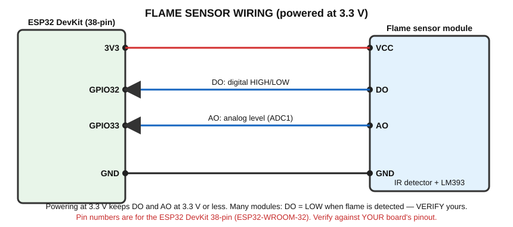

# Flame Sensor — Infrared Flame Detection (Warning Prototype)

> ⚠️ **Educational prototype only — not a certified fire detector.**
> **Components:** ESP32, flame sensor module (with LM393 comparator), active buzzer, LED + 220 Ω.

## A. What does it detect?
The **infrared (IR) light** produced by a flame (a typical module is most sensitive around 760–1100 nm, at a range of tens of cm).

## B. Real-world working principle
```
Flame
↓
Infrared radiation
↓
IR-sensitive detector (photodiode / phototransistor, usually a black LED-like part)
↓
Electrical signal
↓
Comparator / output
↓
ESP32
```
Flames radiate infrared light. The detector's current changes with the IR intensity.

## C. How does the sensor generate its electrical signal?
- The detector and a resistor form a divider → a voltage that changes with IR intensity. That voltage is the **AO (analog output)**.
- An **LM393 comparator** compares that voltage with a threshold set by the blue potentiometer and outputs **DO (digital output)**: HIGH or LOW.

### AO and DO
| Output | Meaning |
|---|---|
| **DO** | Digital flame yes/no; sensitivity adjusted with the potentiometer |
| **AO** | Analog level; typically *lower* voltage with stronger IR on many modules (varies) |

### ⚠️ Active HIGH or LOW — verify!
Most modules output **LOW when a flame is detected** (active LOW) and often light a small LED on the board. But some are the opposite. **Test yours:** open the Serial Monitor, bring a candle/lighter flame near (supervised, at a safe distance) and see whether DO goes to 0 or 1, then set `FLAME_ACTIVE_LOW` in the code.

## D. What signal reaches the ESP32?
A digital HIGH/LOW (DO) and an analog voltage (AO). **Powering the module from 3V3** keeps both signals within 3.3 V.

## E. How does the ESP32 read it?
`digitalRead(32)` for DO, `analogRead(33)` for AO (GPIO33 is ADC1).

Note: the sensor also responds to **other IR sources** (sunlight, halogen/incandescent bulbs, TV remotes), so false triggers are common near windows.

## F. Connection diagram


## G. Pin connection table
| Module pin | Connects to |
|---|---|
| VCC | ESP32 **3V3** |
| GND | ESP32 GND |
| DO | **GPIO32** |
| AO | **GPIO33** |
| Buzzer (+) | GPIO25; (−) → GND |
| LED | GPIO26 → 220 Ω → LED (+); (−) → GND |

## H. Arduino code

```cpp
// Flame sensor warning PROTOTYPE (educational - NOT a certified fire detector)
// Wiring: module VCC -> 3V3, GND -> GND, DO -> GPIO32, AO -> GPIO33
//         GPIO25 -> active buzzer (+), GPIO26 -> 220 ohm -> LED

const int FLAME_DO_PIN = 32;
const int FLAME_AO_PIN = 33;
const int BUZZER_PIN = 25;
const int LED_PIN = 26;

// Most modules give DO = LOW when a flame is detected. VERIFY YOURS and change if needed.
const bool FLAME_ACTIVE_LOW = true;

void setup()
{
  Serial.begin(115200);
  pinMode(FLAME_DO_PIN, INPUT);
  pinMode(BUZZER_PIN, OUTPUT);
  pinMode(LED_PIN, OUTPUT);
}

void loop()
{
  int digitalState = digitalRead(FLAME_DO_PIN);   // HIGH or LOW
  int analogValue = analogRead(FLAME_AO_PIN);     // 0 to 4095

  bool flameDetected;
  if (FLAME_ACTIVE_LOW)
  {
    flameDetected = (digitalState == LOW);
  }
  else
  {
    flameDetected = (digitalState == HIGH);
  }

  Serial.print("DO: ");
  Serial.print(digitalState);
  Serial.print("   AO: ");
  Serial.print(analogValue);

  if (flameDetected)
  {
    digitalWrite(BUZZER_PIN, HIGH);
    digitalWrite(LED_PIN, HIGH);
    Serial.println("   -> FLAME DETECTED");
  }
  else
  {
    digitalWrite(BUZZER_PIN, LOW);
    digitalWrite(LED_PIN, LOW);
    Serial.println("   -> no flame");
  }

  delay(300);
}
```

## I. Line-by-line explanation
| Code | Meaning |
|---|---|
| `FLAME_ACTIVE_LOW = true` | Says DO is LOW when a flame is seen. Change if your module is opposite |
| `digitalRead(FLAME_DO_PIN)` | Reads the module's yes/no output |
| `analogRead(FLAME_AO_PIN)` | Reads the IR level as 0–4095 |
| `bool flameDetected;` | A variable that can only be true or false |
| `if (FLAME_ACTIVE_LOW) {...}` | Chooses how to interpret DO |
| `digitalWrite(...HIGH)` | Turns buzzer and LED ON when flame is detected |

## J. Expected output
```
DO: 1   AO: 3900   -> no flame
DO: 0   AO: 850    -> FLAME DETECTED
```
(AO values depend on the module.)

## What is happening physically?
| Question | Answer |
|---|---|
| Physically | IR from the flame reaches the detector and changes its current |
| Signal | Voltage (AO) and comparator output (DO) |
| How ESP32 receives | Digital input and ADC |
| Program | Interprets DO polarity, decides flame yes/no |
| Output | Serial, LED, buzzer |

## K. Applications (demonstrations)
1. Flame warning
2. Fire-detection prototype
3. Alarm system demonstration

Certified fire alarms use tested, standards-approved detection. This is a learning prototype.

## L. Troubleshooting
| Problem | Check |
|---|---|
| Always "flame" | Sunlight/bulb IR; potentiometer too sensitive; polarity setting wrong |
| Never detects | Potentiometer too insensitive; too far (keep 10–30 cm); wrong pin |
| Inverted behaviour | Change `FLAME_ACTIVE_LOW` |
| AO stuck | Not connected to an ADC1 pin; VCC missing |

## M. Safety precautions
- **Fire hazard:** test only with a small candle/lighter, **supervised**, on a non-flammable surface, away from paper, hair and clothing; keep water/extinguisher accessible.
- Never use flammable liquids.
- Not a life-safety device.

## N. Student exercise
1. Find the polarity of your module and note it.
2. Record AO values at 10, 20, 30 cm from a flame (supervised).
3. Test with a phone torch and with sunlight; which triggers the sensor?
4. Add an "AO above X" second condition.

Next: [TCS3200](../TCS3200/README.md)
