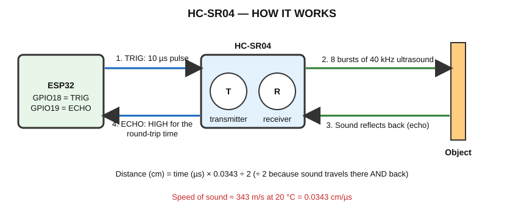
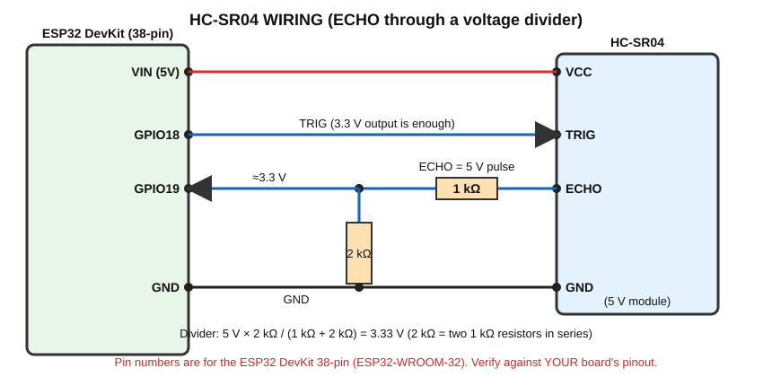

# HC-SR04 — Ultrasonic Distance Sensor

> **Components:** ESP32, HC-SR04, 1 kΩ × 3 (or 1 kΩ + 2 kΩ), active buzzer, breadboard, jumper wires.
> ⚠️ **Voltage warning:** the HC-SR04 normally runs from **5 V** and its ECHO output is a **5 V** signal. **Never connect ECHO directly to an ESP32 GPIO.** Use the voltage divider below.

## A. What does it detect?
The **distance** to an object in front of it (typically about 2 cm to 400 cm).

## B. Real-world working principle
It works like a bat or ship sonar. **Ultrasound** is sound too high-pitched for humans to hear (the module uses 40 kHz).



```
ESP32 → TRIG (10 µs pulse)
HC-SR04 → sends an ultrasonic burst
Sound → travels to object
Reflection → returns to the receiver
HC-SR04 → makes an ECHO pulse
ESP32 → measures the pulse width
Distance calculated
```

## C. How does the sensor generate its electrical signal?
1. The ESP32 gives a **10 µs HIGH pulse** on **TRIG**.
2. The module's transmitter (T) sends **8 short bursts of 40 kHz sound**.
3. **At the same moment**, the module's control chip raises **ECHO to HIGH**.
4. When the receiver (R) hears the reflected sound, the chip pulls **ECHO back to LOW**.
5. So **the ECHO HIGH time = the time the sound needed to go to the object and come back.**
   If nothing is detected, ECHO ends after a long timeout (about 38 ms on many modules).

**Distance = time × speed of sound / 2**

- Speed of sound ≈ 343 m/s (at ≈20 °C) = **0.0343 cm/µs**
- Divide by 2 because the sound travelled to the object **and back**.
- Example: ECHO = 1166 µs → 1166 × 0.0343 / 2 ≈ **20 cm**.

## D. What signal reaches the ESP32?
A **pulse-width signal** on ECHO: a HIGH pulse whose **length** (in microseconds) carries the distance. The pulse is **5 V** high on a normal HC-SR04 → must be reduced to ≈3.3 V.

## E. How does the ESP32 read it?
`pulseIn(ECHO_PIN, HIGH, timeout)` waits for the pin to go HIGH, then measures how many **microseconds** it stays HIGH. It returns **0** if no pulse arrives before the timeout.

### Voltage compatibility and the safe divider
| Item | Voltage |
|---|---|
| HC-SR04 VCC | 5 V (from ESP32 `VIN`/`5V` pin when powered by USB) |
| TRIG input | 3.3 V from ESP32 is normally enough to trigger |
| **ECHO output** | **≈5 V** → **too high for GPIO** |

**Voltage divider:** ECHO → **1 kΩ** → node → **GPIO19**; node → **2 kΩ** → GND.

`Vnode = 5 V × 2 kΩ / (1 kΩ + 2 kΩ) = 3.33 V` ✅

No 2 kΩ? Use **two 1 kΩ in series** to GND. Other similar ratios (e.g. 1 kΩ + 1.8 kΩ) also work.

Some modules (e.g. "HC-SR04+" or 3.3 V versions) output 3.3 V; **check your module's documentation**. The divider is still safe to use with them (you just get ≈2.2 V, which is normally still read as HIGH).

## F. Connection diagram


## G. Pin connection table
| HC-SR04 pin | Connects to |
|---|---|
| VCC | ESP32 **VIN (5 V)** |
| TRIG | ESP32 **GPIO18** |
| ECHO | **1 kΩ** → node → **GPIO19**; node → **2 kΩ** → GND |
| GND | ESP32 GND (common ground) |
| Buzzer (+) | GPIO25; buzzer (−) → GND |

The 5 V (`VIN`) pin only carries 5 V when the board is powered from USB. Identify it by voltage if unsure.

## H. Arduino code — Obstacle Detection

```cpp
// HC-SR04 obstacle detector
// Wiring: VIN(5V) -> VCC, GND -> GND, GPIO18 -> TRIG,
//         ECHO -> 1 kohm -> node -> GPIO19, node -> 2 kohm -> GND   (voltage divider!)
//         GPIO25 -> active buzzer (+), buzzer (-) -> GND

const int TRIG_PIN = 18;
const int ECHO_PIN = 19;
const int BUZZER_PIN = 25;

const float ALERT_DISTANCE_CM = 20.0;        // Buzzer ON if closer than this
const unsigned long TIMEOUT_US = 30000;      // Stop waiting for echo after 30 ms (about 5 m)

// Measure distance in centimetres. Returns -1 if no echo was received.
float readDistanceCm()
{
  digitalWrite(TRIG_PIN, LOW);
  delayMicroseconds(2);
  digitalWrite(TRIG_PIN, HIGH);              // 10 microsecond trigger pulse
  delayMicroseconds(10);
  digitalWrite(TRIG_PIN, LOW);

  unsigned long echoTime = pulseIn(ECHO_PIN, HIGH, TIMEOUT_US);   // microseconds

  if (echoTime == 0)
  {
    return -1.0;                             // Timeout: nothing detected
  }
  return echoTime * 0.0343 / 2.0;            // Speed of sound = 0.0343 cm/us, divide by 2 (go and return)
}

void setup()
{
  Serial.begin(115200);
  pinMode(TRIG_PIN, OUTPUT);
  pinMode(ECHO_PIN, INPUT);
  pinMode(BUZZER_PIN, OUTPUT);
}

void loop()
{
  float distance = readDistanceCm();

  if (distance < 0)
  {
    Serial.println("No echo received");
    digitalWrite(BUZZER_PIN, LOW);
  }
  else
  {
    Serial.print("Distance: ");
    Serial.print(distance, 1);
    Serial.println(" cm");

    if (distance < ALERT_DISTANCE_CM)
    {
      digitalWrite(BUZZER_PIN, HIGH);        // Obstacle close -> buzzer ON
    }
    else
    {
      digitalWrite(BUZZER_PIN, LOW);
    }
  }

  delay(200);
}
```

## I. Line-by-line explanation
| Code | Meaning |
|---|---|
| `TIMEOUT_US = 30000` | Give up waiting after 30 ms (about 5 m) so the program never hangs |
| `digitalWrite(TRIG_PIN, LOW); delayMicroseconds(2);` | Make sure TRIG starts LOW |
| `digitalWrite(TRIG_PIN, HIGH); delayMicroseconds(10);` | The 10 µs trigger pulse. `delayMicroseconds` waits microseconds |
| `pulseIn(ECHO_PIN, HIGH, TIMEOUT_US)` | Measures how long ECHO stays HIGH |
| `if (echoTime == 0) return -1.0;` | 0 means timeout → "no echo" |
| `echoTime * 0.0343 / 2.0` | Converts time to centimetres |
| `float readDistanceCm()` | Your own function that returns a decimal number |
| `if (distance < ALERT_DISTANCE_CM)` | The decision: obstacle closer than the limit |
| `digitalWrite(BUZZER_PIN, HIGH)` | ACT: sound the buzzer |

## J. Expected output
```
Distance: 45.2 cm
Distance: 44.9 cm
Distance: 18.3 cm      ← buzzer ON
No echo received
```

## What is happening physically?
| Question | Answer |
|---|---|
| Physically | Sound waves travel, reflect and return |
| Signal | ECHO HIGH pulse; its width = travel time |
| How ESP32 receives | Through divider, `pulseIn()` counts the pulse duration |
| Program | Converts time → distance → compares with limit |
| Output | Serial text + buzzer |

## K. Applications
1. **Obstacle detection** (this program)
2. **Car parking sensor:** closer = faster beeps → [`HC_SR04_Parking.ino`](HC_SR04_Parking/HC_SR04_Parking.ino)
3. **Water tank level:** sensor at the top, distance to water surface → percentage → [`HC_SR04_Tank_Level.ino`](HC_SR04_Tank_Level/HC_SR04_Tank_Level.ino)

### Parking sensor — key idea
Beep gap = distance × 5 ms (50 cm → 250 ms pause; 20 cm → 100 ms). Below 10 cm the buzzer stays ON. Uses the same `readDistanceCm()` function.

### Water tank level — key idea
Level % = (EMPTY − distance) × 100 / (EMPTY − FULL), limited to 0–100. **Measure EMPTY and FULL distances in your own tank**, and keep the electronics **dry** (a demonstration only; use waterproof sensors in real tanks).

## L. Troubleshooting
| Problem | Check |
|---|---|
| Always "No echo" | VCC not 5 V; ECHO not connected through divider; TRIG/ECHO swapped |
| Distance random/jumpy | Soft or angled surface (cloth, foam); object narrower than beam; loose wires |
| Reads too short | Object closer than 2 cm; reflections from table/wall nearby |
| Reads 0 / 3 cm constantly | ECHO wired directly to GPIO or power problem |
| Wrong scale | Wrong divisor; speed-of-sound formula typed wrong |

## M. Safety precautions
- **Never** connect the 5 V ECHO directly to an ESP32 GPIO.
- Keep sensors dry.
- Ultrasound is inaudible to humans but may disturb pets; do not run continuously near them.

## N. Student exercise
1. Print distance in **cm and inches** (1 in = 2.54 cm).
2. Change the alert distance to 10 cm and 50 cm. Observe.
3. Use two thresholds: LED at < 50 cm, buzzer at < 20 cm.
4. Measure the same object with a ruler. How accurate is the sensor?

Next: [DHT11](../DHT11/README.md)
