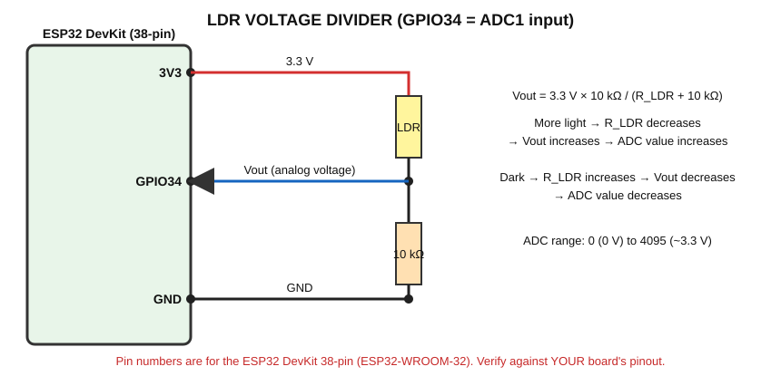

# LDR — Light Dependent Resistor (Automatic Night Lamp)

> **Prerequisites:** [LED](../../03_Basic_Experiments/LED_Blink/README.md), [Sensor Basics](../00_Sensor_Basics.md)
> **Components:** ESP32, LDR, 10 kΩ resistor, LED + 220 Ω resistor, breadboard, jumper wires.

## A. What does it detect?
**Light intensity** (how bright the surroundings are).

## B. Real-world working principle
An LDR is a resistor made of a light-sensitive semiconductor material. When light falls on it, more electric charge carriers are freed, so it conducts better.

> **More light → LDR resistance DECREASES.**
> **Less light (dark) → LDR resistance INCREASES.**

Typical values (they vary between LDR types): roughly a few kΩ in bright light, hundreds of kΩ or more in darkness.

## C. How does the sensor generate its electrical signal?
An LDR itself does **not** create a voltage; it only changes its **resistance**. To get a voltage we put it in a **voltage divider**.

**Voltage divider:** two resistors in series across a supply. The voltage at the junction depends on the ratio of the resistors.

```
3.3 V
 |
LDR
 |
 +------ to ESP32 ADC (GPIO34)
 |
10 kΩ
 |
GND
```

**Equation for this orientation (LDR on top):**

`Vout = 3.3 V × R_fixed / (R_LDR + R_fixed)`  with `R_fixed = 10 kΩ`

| Light | R_LDR | Vout | ADC value |
|---|---|---|---|
| Bright | low (e.g. 2 kΩ) | 3.3 × 10/(2+10) = **2.75 V** | high (≈3400) |
| Medium | ≈10 kΩ | 3.3 × 10/20 = **1.65 V** | mid (≈2050) |
| Dark | high (e.g. 100 kΩ) | 3.3 × 10/110 = **0.30 V** | low (≈370) |

(ADC numbers are approximate; the ESP32 ADC is not perfectly linear.)

## D. What signal reaches the ESP32?
An **analog voltage** between roughly 0 V and 3.3 V on GPIO34.

## E. How does the ESP32 read it?
**Why can't `analogRead()` measure resistance directly?** The ADC only measures **voltage**, not resistance. That is why the divider is needed: it converts resistance change into voltage change.

**ADC** = Analog-to-Digital Converter. It converts the voltage into a number **0 to 4095** (12-bit): 0 ≈ 0 V, 4095 ≈ about 3.3 V.

```
Light → LDR resistance changes → voltage divider → analog voltage → ESP32 ADC → ADC value
```

For the orientation used here (**LDR on the 3.3 V side**): more light → ADC value **increases**. If you swap the LDR and the 10 kΩ, the direction reverses; this handbook always uses the orientation shown.

## F. Connection diagram


## G. Pin connection table
| Component | Connects to |
|---|---|
| LDR leg 1 | ESP32 **3V3** |
| LDR leg 2 | junction node → **GPIO34** |
| 10 kΩ leg 1 | junction node (same as LDR leg 2) |
| 10 kΩ leg 2 | ESP32 **GND** |
| LED via 220 Ω | GPIO26 → 220 Ω → LED (+); LED (−) → GND |

GPIO34 is ADC1 and input-only (perfect for analog reading).

## H. Arduino code (Automatic Night Lamp)
> Step 1: first comment out the LED lines (or just watch the numbers) and observe raw ADC values in light and dark. Step 2: choose `DARK_THRESHOLD` between them.

```cpp
// LDR automatic night lamp
// Wiring: 3V3 -> LDR -> GPIO34 -> 10 kohm -> GND   (GPIO34 = ADC1 input)
//         GPIO26 -> 220 ohm -> LED -> GND

const int LDR_PIN = 34;             // Analog input (junction of LDR and 10 kohm resistor)
const int LED_PIN = 26;             // Lamp (LED)
const int DARK_THRESHOLD = 1500;    // CHANGE THIS after observing your own readings

void setup()
{
  Serial.begin(115200);
  pinMode(LED_PIN, OUTPUT);
}

void loop()
{
  int ldrValue = analogRead(LDR_PIN);            // 0 to 4095
  float voltage = ldrValue * 3.3 / 4095.0;       // Approximate voltage at the pin

  Serial.print("ADC value: ");
  Serial.print(ldrValue);
  Serial.print("   Voltage (approx): ");
  Serial.print(voltage, 2);
  Serial.print(" V");

  if (ldrValue < DARK_THRESHOLD)                 // Low value = little light = dark
  {
    digitalWrite(LED_PIN, HIGH);
    Serial.println("   -> DARK  -> LED ON");
  }
  else
  {
    digitalWrite(LED_PIN, LOW);
    Serial.println("   -> LIGHT -> LED OFF");
  }

  delay(500);
}
```

## I. Line-by-line explanation
| Code | Meaning |
|---|---|
| `const int LDR_PIN = 34;` | Names the analog input pin |
| `const int DARK_THRESHOLD = 1500;` | The decision value. **Must be found experimentally** — every LDR and room is different |
| `analogRead(LDR_PIN)` | Returns 0–4095 |
| `ldrValue * 3.3 / 4095.0` | Converts the number back to an approximate voltage |
| `Serial.print(voltage, 2)` | Prints with 2 decimal places |
| `if (ldrValue < DARK_THRESHOLD)` | Lower value = less light = dark |
| `digitalWrite(LED_PIN, HIGH)` | Turns the lamp ON when dark |
| `delay(500)` | Two readings per second |

### How to find the threshold
1. Upload the program, open Serial Monitor.
2. Note the value in normal room light (e.g. 2800).
3. Cover the LDR with your hand (e.g. 400).
4. Pick a value between them (e.g. 1500) and set `DARK_THRESHOLD`.

## J. Expected output
```
ADC value: 2850   Voltage (approx): 2.30 V   -> LIGHT -> LED OFF
ADC value: 2790   Voltage (approx): 2.25 V   -> LIGHT -> LED OFF
ADC value: 420    Voltage (approx): 0.34 V   -> DARK  -> LED ON
```

## What is happening physically? (Automatic Night Lamp)
```
DAY:   high light → LDR resistance decreases → ADC value increases → ESP32 detects light → LED OFF
NIGHT: low light  → LDR resistance increases → ADC value decreases → ESP32 detects darkness → LED ON
```
| Question | Answer |
|---|---|
| Physically | Photons free charge carriers in the LDR, lowering its resistance |
| Signal | Analog voltage from the divider |
| How ESP32 receives it | ADC converts to 0–4095 |
| Program | Compares with the threshold |
| Output | LED + Serial text |

## K. Simple real-life applications
1. Automatic night lamp
2. Street-light control
3. Automatic display/screen brightness

## L. Troubleshooting
| Problem | Check |
|---|---|
| Always 0 | GPIO34 not connected to the junction; 3V3 not connected |
| Always ~4095 | Junction shorted to 3V3; 10 kΩ not connected to GND |
| Values reversed | LDR and resistor swapped relative to the diagram |
| Unstable values | Loose wires; AC lamp flicker (50 Hz light); average several readings |
| LED not lighting | Check LED polarity and resistor; see [LED chapter](../../03_Basic_Experiments/LED_Blink/README.md) |

## M. Safety precautions
- Use only 3.3 V for this circuit.
- Do not shine very strong light/laser at close range; not needed.
- Never connect the LED without a resistor.

## N. Student exercise
1. Record ADC values for: bright light, room light, hand shadow, fully covered. Make a table.
2. Add a second LED that lights only in **very** dark conditions.
3. Print "DARK", "DIM", "BRIGHT" using two thresholds.
4. Swap the LDR and resistor positions. Predict, then verify what happens to the ADC readings.

Next project: [Automatic Night Lamp (with hysteresis)](../../05_Mini_Projects/Automatic_Night_Lamp/README.md) · Next sensor: [HC-SR04](../HC_SR04/README.md)
