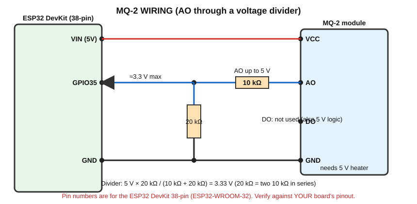

# MQ-2 — Gas and Smoke Sensor (Warning Prototype)

> ⚠️ **This is an educational prototype. An MQ-2 hobby module is NOT a certified gas or smoke detector. Never rely on it to protect people or property.**
> ⚠️ **Voltage warning:** the module runs from **5 V**; its **AO output can reach up to about 5 V**. Use the voltage divider shown before connecting to the ESP32.
> **Components:** ESP32, MQ-2 module, 2 × 10 kΩ + 1 × 10 kΩ (three 10 kΩ resistors), active buzzer, LED + 220 Ω.

## A. What does it detect?
Several **combustible gases and smoke**: LPG, propane, methane, hydrogen, alcohol vapour, smoke, carbon monoxide. It **cannot tell which gas** it is sensing.

## B. Real-world working principle
- Inside the sensor is a **heated** sensing element made of a metal-oxide semiconductor (tin dioxide, SnO₂) and a small heater coil.
- In clean air, the hot SnO₂ has a certain (high) resistance.
- When combustible gas is present, chemical reactions on the hot surface **decrease the resistance** of the element.
- The heater is needed to make these reactions happen; that is why the sensor **gets warm** and needs a **warm-up time** (see below).

## C. How does the sensor generate its electrical signal?
The element's resistance change is turned into a voltage by a **voltage divider** on the module (sensor element + a load resistor). On typical modules:

**More gas → element resistance decreases → AO voltage increases.**

The module also has a **comparator (LM393)** and a small blue **potentiometer**. The comparator compares AO with a threshold set by the potentiometer and produces the **DO** signal.

### AO vs DO
| Output | Signal | Meaning |
|---|---|---|
| **AO** (Analog Output) | Voltage varying continuously (0 to ~5 V) | Relative gas level |
| **DO** (Digital Output) | HIGH or LOW only | Gas level above / below the potentiometer threshold (polarity varies by module; a small LED on the module usually shows it) |

## D. What signal reaches the ESP32?
An **analog voltage** (from AO, reduced by the divider). DO is also 5 V-level on a 5 V-powered module, so it needs a divider too; this handbook uses **AO only**.

## E. How does the ESP32 read it?
`analogRead(35)` returns 0–4095 for 0–3.3 V at the pin.

### Voltage compatibility and divider
`Vnode = Vao × 20 kΩ / (10 kΩ + 20 kΩ) = Vao × 0.667`. With Vao = 5 V → **3.33 V** at the ESP32 pin (right at the limit). Build 20 kΩ from **two 10 kΩ in series**. Readings near the top of the range will saturate (they stop increasing), which is fine for a warning demo.

### Important: ADC value is NOT ppm
The number from `analogRead()` is **only a relative reading** (0–4095).
- **ppm** (parts per million) is a real concentration unit.
- Converting to ppm requires: the sensor curve, the load resistor value, the sensor's clean-air resistance (R0), temperature/humidity compensation, the specific gas, and calibration against a known gas concentration with proper equipment.
- A hobby module without such calibration **cannot give reliable ppm**. Say "ADC value" or "relative level", never "ppm", in this course.

### Warm-up
The heater needs time. The datasheet recommends a long initial pre-heat of the sensor (many hours, one time). Each time you power it, wait **several minutes** for stable readings. The program uses a short 30 s warm-up for classroom convenience; increase it for better results.
Take the **baseline in clean air** — otherwise the threshold makes no sense.

## F. Connection diagram


## G. Pin connection table
| MQ-2 pin | Connects to |
|---|---|
| VCC | ESP32 **VIN (5 V)** |
| GND | ESP32 GND |
| AO | **10 kΩ** → node → **GPIO35**; node → **20 kΩ** (2 × 10 kΩ) → GND |
| DO | not connected |
| Buzzer (+) | GPIO25; buzzer (−) → GND |
| LED | GPIO26 → 220 Ω → LED (+); LED (−) → GND |

## H. Arduino code

```cpp
// MQ-2 gas/smoke warning PROTOTYPE (educational - NOT a certified safety device)
// Wiring: MQ-2 VCC -> VIN(5V), GND -> GND,
//         AO -> 10 kohm -> node -> GPIO35, node -> 20 kohm (2 x 10 kohm) -> GND
//         GPIO25 -> active buzzer (+), GPIO26 -> 220 ohm -> LED

const int MQ2_PIN = 35;
const int BUZZER_PIN = 25;
const int LED_PIN = 26;

const int WARMUP_SECONDS = 30;     // Use longer (2-5 minutes) for better stability
const int ALERT_MARGIN = 300;      // Alarm if reading rises this much above clean-air baseline

int baseline = 0;                  // Clean-air reading measured after warm-up

// Average 10 readings to reduce noise
int readAverage()
{
  long sum = 0;
  for (int i = 0; i < 10; i++)
  {
    sum += analogRead(MQ2_PIN);
    delay(10);
  }
  return sum / 10;
}

void setup()
{
  Serial.begin(115200);
  pinMode(BUZZER_PIN, OUTPUT);
  pinMode(LED_PIN, OUTPUT);

  Serial.println("MQ-2 warming up in CLEAN AIR...");
  for (int s = WARMUP_SECONDS; s > 0; s--)
  {
    Serial.print("Warm-up: ");
    Serial.print(s);
    Serial.println(" s");
    delay(1000);
  }

  baseline = readAverage();
  Serial.print("Baseline (clean air) ADC value: ");
  Serial.println(baseline);
}

void loop()
{
  int value = readAverage();

  Serial.print("MQ-2 ADC value: ");
  Serial.print(value);
  Serial.print("   (baseline ");
  Serial.print(baseline);
  Serial.print(")");

  if (value > baseline + ALERT_MARGIN)
  {
    digitalWrite(BUZZER_PIN, HIGH);
    digitalWrite(LED_PIN, HIGH);
    Serial.println("   -> GAS/SMOKE WARNING");
  }
  else
  {
    digitalWrite(BUZZER_PIN, LOW);
    digitalWrite(LED_PIN, LOW);
    Serial.println("   -> normal");
  }

  delay(300);
}
```

## I. Line-by-line explanation
| Code | Meaning |
|---|---|
| `WARMUP_SECONDS = 30` | Time to let the heater stabilise (increase for real use) |
| `readAverage()` | Takes 10 readings and returns their average; reduces noise |
| `sum += analogRead(MQ2_PIN)` | Adds each reading; `long` avoids overflow |
| `baseline = readAverage();` | Records the **clean-air** value once after warm-up |
| `value > baseline + ALERT_MARGIN` | Alarm if the reading is clearly above the baseline |
| `ALERT_MARGIN = 300` | Starting value; tune it by testing (see below) |

### Safe test
Use a small amount of gas from a **butane lighter without flame** (release gas near the sensor for a moment) in a **well-ventilated area**, away from ignition sources. Alternatively use alcohol vapour from a cotton swab held at distance. Never test near flames or in closed rooms.

## J. Expected output
```
Warm-up: 30 s
...
Baseline (clean air) ADC value: 420
MQ-2 ADC value: 425   (baseline 420)   -> normal
MQ-2 ADC value: 1350  (baseline 420)   -> GAS/SMOKE WARNING
```
(Numbers differ for every module.)

## What is happening physically?
| Question | Answer |
|---|---|
| Physically | Gas molecules react on the hot SnO₂ surface and lower its resistance |
| Signal | AO voltage rises; divider makes it ESP32-safe |
| How ESP32 receives | ADC converts to a number |
| Program | Compares with clean-air baseline + margin |
| Output | Serial text, buzzer, LED |

## K. Applications (educational demonstrations)
1. Gas warning prototype
2. Smoke warning prototype
3. Kitchen monitoring demonstration

**Real safety systems** use certified detectors (standards-tested, calibrated, with fail-safe design). This module is for learning how sensing and thresholds work.

## L. Troubleshooting
| Problem | Check |
|---|---|
| Readings drift | Not warmed up; temperature/humidity changes |
| Always high | Gas in the room; no divider; sensor still burn-in |
| Always ~0 | AO not connected; divider wired wrong |
| Values jump | Add averaging; check power supply (USB port with weak power) |
| False alarms | Increase margin; measure baseline in clean air |

## M. Safety precautions
- **Prototype only. Not for life safety.**
- The heater gets hot; do not touch it; keep away from flammable materials.
- Test only with tiny amounts of gas, ventilated area, no flames or sparks.
- The AO output can reach 5 V: use the divider.

## N. Student exercise
1. Record the baseline over 5 minutes in clean air. How much does it drift?
2. Find a good `ALERT_MARGIN` by testing with a lighter's unlit gas (ventilated).
3. Print "LOW / MEDIUM / HIGH" using two margins.
4. Explain in writing why the reading is not in ppm.

Next: [Flame Sensor](../Flame_Sensor/README.md)
