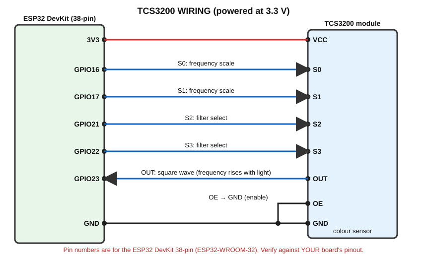

# TCS3200 — Colour Sensor (Colour Sorting)

> **Components:** ESP32, TCS3200 module, white and black paper, coloured objects (red/green/blue), jumper wires.

## A. What does it detect?
The **colour of a surface**, measured as the intensity of **red, green and blue** reflected light.

## B. Real-world working principle
```
Object
↓
reflected light (from the module's white LEDs)
↓
photodiodes with colour filters
↓
current → frequency converter
↓
square-wave frequency on OUT
↓
ESP32
```
- The module's white LEDs light the object.
- The chip has an **8 × 8 array of photodiodes** (64): 16 with **red** filters, 16 with **green**, 16 with **blue**, 16 with **no filter (clear)**.
- We select **one filter type at a time**; only those photodiodes are read.

### Why this is different from an LDR
An LDR measures **total brightness** only. The TCS3200 separates light into **red, green and blue parts** so a colour can be identified.

## C. How does the sensor generate its electrical signal?
The selected photodiodes make a current proportional to the light. A converter inside turns that current into a **square wave** on **OUT**: **more light of the selected colour → higher frequency** (shorter pulses).

### S0 / S1 — output frequency scaling
| S0 | S1 | Output frequency |
|---|---|---|
| LOW | LOW | Power down |
| LOW | HIGH | 2 % |
| HIGH | LOW | **20 %** (used here) |
| HIGH | HIGH | 100 % |

Lower scaling gives lower frequencies, easier for the ESP32 to measure.

### S2 / S3 — colour filter selection
| S2 | S3 | Filter |
|---|---|---|
| LOW | LOW | **Red** |
| LOW | HIGH | **Blue** |
| HIGH | HIGH | **Green** |
| HIGH | LOW | Clear (no filter) |

### OE pin
Output Enable, active LOW. Connect it to GND (many modules already do it; if your board has OE, tie it to GND).

## D. What signal reaches the ESP32?
A **square wave** (frequency depends on colour intensity). With the module powered from **3V3**, OUT swings 0–3.3 V. Do **not** power from 5 V without verifying the output level.

## E. How does the ESP32 read it?
`pulseIn(OUT_PIN, LOW, timeout)` measures the **LOW pulse width** in microseconds. **Shorter pulse = higher frequency = stronger colour component.**

**How red, green and blue are obtained:**
1. Set S2/S3 for RED → measure pulse.
2. Set S2/S3 for BLUE → measure pulse.
3. Set S2/S3 for GREEN → measure pulse.
4. Convert each pulse width to 0–255 using white/black calibration (`map()`).

### Calibration and lighting
Colour classification is **not reliable without calibration and controlled lighting**:
- Use a fixed distance (about 1–3 cm) and a shaded enclosure (no room-light changes).
- Measure a **white** sheet (maximum light → smallest pulses) and a **black** sheet (minimum light → largest pulses) for each filter.
- Enter these numbers in the code.

## F. Connection diagram


## G. Pin connection table
| TCS3200 pin | ESP32 |
|---|---|
| VCC | **3V3** |
| GND | GND |
| S0 | GPIO16 |
| S1 | GPIO17 |
| S2 | GPIO21 |
| S3 | GPIO22 |
| OUT | GPIO23 |
| OE | GND |
| LED pin (if present) | leave as module default |

GPIO21/22 are I2C pins by default but work as normal pins here (we do not use I2C in this experiment).

## H. Arduino code

```cpp
// TCS3200 colour sensor - RGB measurement and simple colour classification
// Wiring (module powered at 3.3 V): S0->GPIO16, S1->GPIO17, S2->GPIO21, S3->GPIO22, OUT->GPIO23, OE->GND

const int S0_PIN = 16;
const int S1_PIN = 17;
const int S2_PIN = 21;
const int S3_PIN = 22;
const int OUT_PIN = 23;

// ---- CALIBRATION VALUES (pulse widths in microseconds) ----
// These are PLACEHOLDERS. Measure your own: hold a WHITE sheet, then a BLACK sheet, about 2 cm away.
long redWhite   = 30,  redBlack   = 200;
long greenWhite = 30,  greenBlack = 200;
long blueWhite  = 30,  blueBlack  = 200;

// Select a filter (S2, S3) and measure the pulse width of OUT (LOW part of the wave)
long readPulse(int s2State, int s3State)
{
  digitalWrite(S2_PIN, s2State);
  digitalWrite(S3_PIN, s3State);
  delay(50);                                  // Let the sensor settle
  return pulseIn(OUT_PIN, LOW, 100000);       // Microseconds; 0 if timeout
}

// Convert a pulse width to a 0-255 colour value using the white/black calibration
int toColorValue(long pulse, long whitePulse, long blackPulse)
{
  if (pulse == 0) return 0;                   // Timeout -> treat as no signal
  long value = map(pulse, whitePulse, blackPulse, 255, 0);
  return constrain(value, 0, 255);
}

void setup()
{
  Serial.begin(115200);
  pinMode(S0_PIN, OUTPUT);
  pinMode(S1_PIN, OUTPUT);
  pinMode(S2_PIN, OUTPUT);
  pinMode(S3_PIN, OUTPUT);
  pinMode(OUT_PIN, INPUT);

  digitalWrite(S0_PIN, HIGH);                 // S0=HIGH, S1=LOW -> 20 % frequency scaling
  digitalWrite(S1_PIN, LOW);
}

void loop()
{
  long redPulse   = readPulse(LOW, LOW);      // S2=LOW,  S3=LOW  -> RED filter
  long bluePulse  = readPulse(LOW, HIGH);     // S2=LOW,  S3=HIGH -> BLUE filter
  long greenPulse = readPulse(HIGH, HIGH);    // S2=HIGH, S3=HIGH -> GREEN filter

  int red   = toColorValue(redPulse,   redWhite,   redBlack);
  int green = toColorValue(greenPulse, greenWhite, greenBlack);
  int blue  = toColorValue(bluePulse,  blueWhite,  blueBlack);

  Serial.print("Pulse R/G/B (us): ");
  Serial.print(redPulse);   Serial.print(" / ");
  Serial.print(greenPulse); Serial.print(" / ");
  Serial.print(bluePulse);
  Serial.print("   RGB value: ");
  Serial.print(red);   Serial.print(", ");
  Serial.print(green); Serial.print(", ");
  Serial.print(blue);

  // Very simple classification: the strongest colour wins if it is clearly stronger than the others
  if (red > green + 30 && red > blue + 30)
  {
    Serial.println("   -> RED   (Bin 1)");
  }
  else if (green > red + 30 && green > blue + 30)
  {
    Serial.println("   -> GREEN (Bin 2)");
  }
  else if (blue > red + 30 && blue > green + 30)
  {
    Serial.println("   -> BLUE  (Bin 3)");
  }
  else
  {
    Serial.println("   -> UNKNOWN (Bin 4)");
  }

  delay(500);
}
```

## I. Line-by-line explanation
| Code | Meaning |
|---|---|
| `digitalWrite(S0_PIN, HIGH); digitalWrite(S1_PIN, LOW);` | Sets 20 % frequency scaling |
| `readPulse(int s2State, int s3State)` | Selects a filter, waits 50 ms, measures pulse |
| `pulseIn(OUT_PIN, LOW, 100000)` | LOW-pulse width in µs; 0 if none within 100 ms |
| `map(pulse, whitePulse, blackPulse, 255, 0)` | Converts white→255 (bright colour) and black→0 |
| `constrain(value, 0, 255)` | Keeps result in range |
| `red > green + 30 && red > blue + 30` | Red counts if clearly stronger than both others (`&&` = AND) |
| `Bin 1/2/3/4` | Colour sorting decision: which bin an object goes into |

### How to calibrate
1. Upload the sketch; open Serial Monitor.
2. Hold a white sheet ≈2 cm from the sensor. Note the three **Pulse R/G/B** values → `redWhite`, `greenWhite`, `blueWhite`.
3. Do the same with black → `redBlack`, `greenBlack`, `blueBlack`.
4. Re-upload and test coloured objects.

## J. Expected output
```
Pulse R/G/B (us): 45 / 110 / 100   RGB value: 230, 60, 70   -> RED   (Bin 1)
Pulse R/G/B (us): 120 / 50 / 105   RGB value: 55, 210, 60   -> GREEN (Bin 2)
```
(Placeholders give inaccurate results until calibrated.)

## What is happening physically?
| Question | Answer |
|---|---|
| Physically | Object reflects colours differently; filtered photodiodes measure each |
| Signal | Square wave; frequency ↔ light intensity |
| How ESP32 receives | `pulseIn()` measures pulse width |
| Program | Reads 3 filters, converts, classifies |
| Output | Serial message (bin number) |

## K. Applications
1. **Colour sorting:** a servo or conveyor sends objects to a bin based on the result (advanced extension)
2. Colour detection
3. Object classification (e.g. ripe/unripe, packaging colour checks)

## L. Troubleshooting
| Problem | Check |
|---|---|
| All pulses 0 | Power missing; OUT not connected; OE not LOW |
| Random colours | No calibration; ambient light changes; distance varies |
| Everything looks white/black | Calibration values wrong |
| Only one colour | S2/S3 wires swapped or loose |

## M. Safety precautions
- Do not look directly into the bright white LEDs at close range for long periods.
- Use 3.3 V supply to keep OUT ESP32-safe.

## N. Student exercise
1. Calibrate with white and black paper and record numbers.
2. Test red, green, blue, yellow objects; which are classified correctly? Why does yellow fail?
3. Add a fourth class "WHITE" (all three values high).
4. Blink a different number of times for each colour using the LED.

Next: [Sensor comparison](../../docs/Sensor_Comparison.md)
