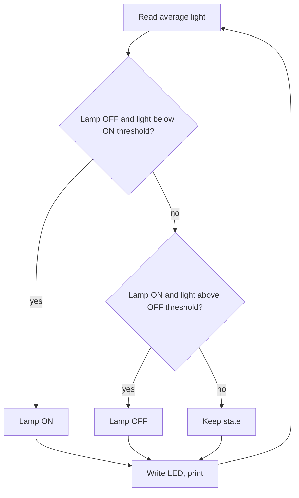

# Project 1 — Automatic Night Lamp (LDR + LED)

## Objective
Turn a lamp ON automatically when it gets dark and OFF when it gets bright, without flickering.

## Components
ESP32, LDR, 10 kΩ, LED, 220 Ω, breadboard, jumper wires.

## Circuit
| From | To |
|---|---|
| 3V3 | LDR leg 1 |
| LDR leg 2 + 10 kΩ leg 1 (node) | GPIO34 |
| 10 kΩ leg 2 | GND |
| GPIO26 | 220 Ω → LED (+); LED (−) → GND |

Diagram: [LDR circuit](../../04_Sensors/LDR/images/ldr_circuit.svg) + [LED circuit](../../03_Basic_Experiments/LED_Blink/images/led_circuit.svg)

## Working
The LDR divider gives a voltage that rises with light. The ESP32 averages 10 ADC readings. Two thresholds (**hysteresis**) prevent flicker: the lamp turns ON below `DARK_ON_THRESHOLD` and OFF only above the higher `LIGHT_OFF_THRESHOLD`.

## Algorithm


## Code
```cpp
// Project 1 - Automatic Night Lamp (LDR + LED)
// Wiring: 3V3 -> LDR -> GPIO34 -> 10 kohm -> GND;  GPIO26 -> 220 ohm -> LED -> GND
// Uses two thresholds (hysteresis) so the lamp does not flicker near the switching point.

const int LDR_PIN = 34;
const int LED_PIN = 26;

const int DARK_ON_THRESHOLD = 1400;    // Below this value -> lamp ON   (measure and adjust!)
const int LIGHT_OFF_THRESHOLD = 1800;  // Above this value -> lamp OFF  (must be higher than the ON value)

bool lampIsOn = false;                 // Remembers the current lamp state

// Average 10 readings to smooth the noise
int readLightLevel()
{
  long sum = 0;
  for (int i = 0; i < 10; i++)
  {
    sum += analogRead(LDR_PIN);
    delay(5);
  }
  return sum / 10;
}

void setup()
{
  Serial.begin(115200);
  pinMode(LED_PIN, OUTPUT);
}

void loop()
{
  int light = readLightLevel();

  if (!lampIsOn && light < DARK_ON_THRESHOLD)
  {
    lampIsOn = true;                   // It became dark
  }
  else if (lampIsOn && light > LIGHT_OFF_THRESHOLD)
  {
    lampIsOn = false;                  // It became bright
  }

  digitalWrite(LED_PIN, lampIsOn ? HIGH : LOW);

  Serial.print("Light level: ");
  Serial.print(light);
  Serial.print("   Lamp: ");
  Serial.println(lampIsOn ? "ON" : "OFF");

  delay(300);
}
```

## Expected output
```
Light level: 2810   Lamp: OFF
Light level: 1320   Lamp: ON
Light level: 1650   Lamp: ON      ← still ON: between the two thresholds
Light level: 1900   Lamp: OFF
```

## Possible improvements
- Calibrate the two thresholds for your room.
- Add a button for manual override.
- Use PWM to dim the LED gradually.
- Add a delay before switching (avoid reacting to a passing shadow).
