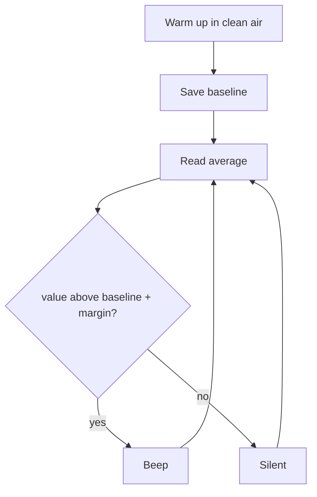

# Project 4 — Gas Warning Prototype (MQ-2 + buzzer)

> ⚠️ **Educational prototype. NOT a certified gas or smoke detector.**

## Objective
Sound a beeping buzzer when the MQ-2 reading rises well above its clean-air baseline.

## Components
ESP32, MQ-2 module, three 10 kΩ resistors, active buzzer, jumper wires.

## Circuit
| From | To |
|---|---|
| MQ-2 VCC | VIN (5 V) |
| MQ-2 GND | GND |
| MQ-2 AO | 10 kΩ → node → GPIO35; node → 20 kΩ (2 × 10 kΩ) → GND |
| Buzzer (+) | GPIO25; (−) → GND |

Diagram: [MQ-2 wiring](../../04_Sensors/MQ2/images/mq2_circuit.svg)

## Working
After a warm-up in clean air the ESP32 stores a **baseline**. It then averages readings and raises the alarm if `value > baseline + margin`. Reading values are **relative ADC numbers, not ppm**.

## Algorithm


## Code
```cpp
// Project 4 - Gas Warning PROTOTYPE (MQ-2 + buzzer)  -  educational, NOT a certified safety device
// Wiring: MQ-2 VCC->VIN(5V), GND->GND, AO->10k->node->GPIO35, node->20k->GND
//         GPIO25 -> active buzzer (+)

const int MQ2_PIN = 35;
const int BUZZER_PIN = 25;

const int WARMUP_SECONDS = 30;
const int ALERT_MARGIN = 300;
int baseline = 0;

int readAverage()
{
  long sum = 0;
  for (int i = 0; i < 10; i++)
  {
    sum += analogRead(MQ2_PIN);
    delay(10);
  }
  return sum / 10;
}

void setup()
{
  Serial.begin(115200);
  pinMode(BUZZER_PIN, OUTPUT);

  Serial.println("Warming up in clean air...");
  delay(WARMUP_SECONDS * 1000UL);
  baseline = readAverage();
  Serial.print("Baseline: ");
  Serial.println(baseline);
}

void loop()
{
  int value = readAverage();
  Serial.print("Value: ");
  Serial.println(value);

  if (value > baseline + ALERT_MARGIN)
  {
    // Beeping alarm: beep, pause, beep
    digitalWrite(BUZZER_PIN, HIGH);
    delay(200);
    digitalWrite(BUZZER_PIN, LOW);
    delay(200);
  }
  else
  {
    digitalWrite(BUZZER_PIN, LOW);
    delay(300);
  }
}
```

## Expected output
```
Warming up in clean air...
Baseline: 415
Value: 418
Value: 1240      ← buzzer beeps
```

## Possible improvements
- Add a status LED and a reset button.
- Latch the alarm until a button is pressed.
- Compare AO-based and DO-based detection.
- Long warm-up (minutes) for stability.

**Safety:** test only with tiny amounts of unlit lighter gas in a ventilated area, far from flames.
