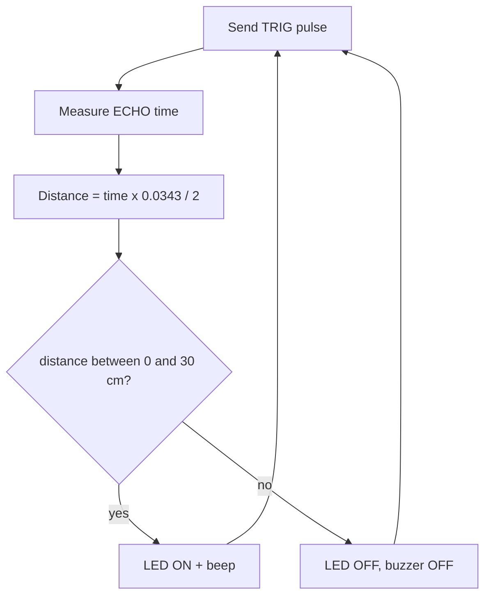

# Project 2 — Obstacle Detector (HC-SR04 + buzzer + LED)

## Objective
Warn with a beeping buzzer and an LED when an object is closer than 30 cm.

## Components
ESP32, HC-SR04, 1 kΩ + 2 kΩ (or 3 × 1 kΩ), active buzzer, LED + 220 Ω, jumper wires.

## Circuit
| From | To |
|---|---|
| HC-SR04 VCC | VIN (5 V) |
| HC-SR04 GND | GND |
| HC-SR04 TRIG | GPIO18 |
| HC-SR04 ECHO | 1 kΩ → node → GPIO19; node → 2 kΩ → GND |
| Buzzer (+) | GPIO25; (−) → GND |
| LED | GPIO26 → 220 Ω → LED (+); (−) → GND |

⚠️ ECHO **must** go through the divider. Diagram: [HC-SR04 wiring](../../04_Sensors/HC_SR04/images/hcsr04_circuit.svg)

## Working
The ESP32 sends a trigger pulse, measures the ECHO pulse width, computes distance, and turns the LED and buzzer on when the distance is below the limit.

## Algorithm


## Code
```cpp
// Project 2 - Obstacle Detector (HC-SR04 + buzzer + LED)
// Wiring: VIN(5V)->VCC, GND->GND, GPIO18->TRIG, ECHO->1k->node->GPIO19, node->2k->GND
//         GPIO25 -> active buzzer (+);  GPIO26 -> 220 ohm -> LED -> GND

const int TRIG_PIN = 18;
const int ECHO_PIN = 19;
const int BUZZER_PIN = 25;
const int LED_PIN = 26;

const float OBSTACLE_CM = 30.0;

float readDistanceCm()
{
  digitalWrite(TRIG_PIN, LOW);
  delayMicroseconds(2);
  digitalWrite(TRIG_PIN, HIGH);
  delayMicroseconds(10);
  digitalWrite(TRIG_PIN, LOW);
  unsigned long echoTime = pulseIn(ECHO_PIN, HIGH, 30000);
  if (echoTime == 0) return -1.0;
  return echoTime * 0.0343 / 2.0;
}

void setup()
{
  Serial.begin(115200);
  pinMode(TRIG_PIN, OUTPUT);
  pinMode(ECHO_PIN, INPUT);
  pinMode(BUZZER_PIN, OUTPUT);
  pinMode(LED_PIN, OUTPUT);
}

void loop()
{
  float distance = readDistanceCm();

  bool obstacle = (distance > 0 && distance < OBSTACLE_CM);

  if (obstacle)
  {
    Serial.print("OBSTACLE at ");
    Serial.print(distance, 1);
    Serial.println(" cm");
    digitalWrite(LED_PIN, HIGH);
    digitalWrite(BUZZER_PIN, HIGH);     // short beep
    delay(100);
    digitalWrite(BUZZER_PIN, LOW);
    delay(100);
  }
  else
  {
    Serial.println("Path clear");
    digitalWrite(LED_PIN, LOW);
    digitalWrite(BUZZER_PIN, LOW);
    delay(200);
  }
}
```

## Expected output
```
Path clear
Path clear
OBSTACLE at 22.4 cm
OBSTACLE at 15.1 cm
Path clear
```

## Possible improvements
- Faster beeping when closer (see the [parking sketch](../../04_Sensors/HC_SR04/HC_SR04_Parking/HC_SR04_Parking.ino)).
- Average 3 readings to remove spikes.
- Add a second sensor for left/right detection.
