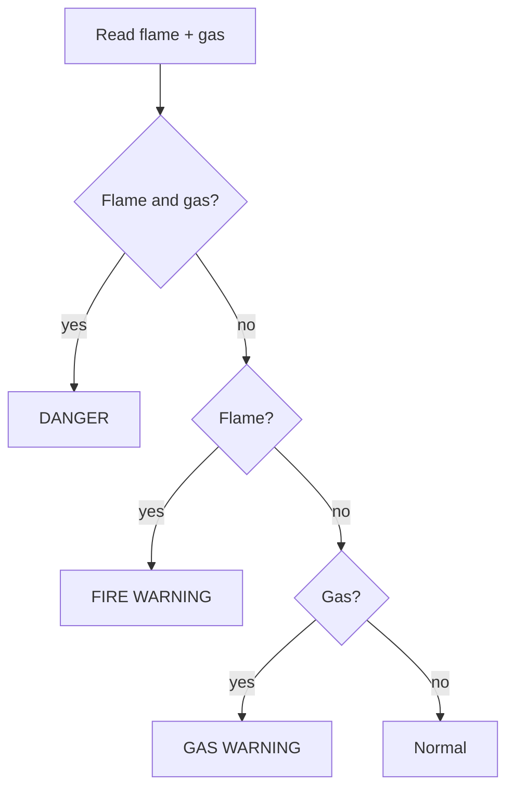

# Project 5 — Smart Safety Demonstrator (Flame + MQ-2 + LED + buzzer)

> ⚠️ **Educational demonstration only. Not a certified fire/gas safety system.**

## Objective
Combine two sensors and two outputs to show different warning levels: gas only, flame only, or both.

## Components
ESP32, flame sensor module, MQ-2 module, three 10 kΩ resistors, LED + 220 Ω, active buzzer, jumper wires.

## Circuit
| From | To |
|---|---|
| Flame VCC / GND / DO | 3V3 / GND / GPIO32 |
| MQ-2 VCC / GND | VIN (5 V) / GND |
| MQ-2 AO | 10 kΩ → node → GPIO35; node → 20 kΩ → GND |
| LED | GPIO26 → 220 Ω → LED (+); (−) → GND |
| Buzzer (+) | GPIO25; (−) → GND |

Diagrams: [Flame](../../04_Sensors/Flame_Sensor/images/flame_circuit.svg) · [MQ-2](../../04_Sensors/MQ2/images/mq2_circuit.svg). All grounds are common.

## Working
| Condition | LED | Buzzer | Message |
|---|---|---|---|
| Nothing | OFF | OFF | normal |
| Gas only | blinks slowly | OFF | GAS WARNING |
| Flame only | ON | beeping | FIRE WARNING |
| Flame + gas | ON | continuous | DANGER |

## Algorithm


## Code
```cpp
// Project 5 - Smart Safety Demonstrator (Flame + MQ-2 + LED + buzzer)
// EDUCATIONAL PROTOTYPE - NOT a certified fire or gas safety system.
// Wiring: Flame module VCC->3V3, GND->GND, DO->GPIO32
//         MQ-2 VCC->VIN(5V), GND->GND, AO->10k->node->GPIO35, node->20k->GND
//         GPIO26 -> 220 ohm -> LED -> GND;  GPIO25 -> active buzzer (+)

const int FLAME_PIN = 32;
const int MQ2_PIN = 35;
const int LED_PIN = 26;
const int BUZZER_PIN = 25;

const bool FLAME_ACTIVE_LOW = true;   // Verify your module!
const int WARMUP_SECONDS = 30;
const int GAS_MARGIN = 300;
int gasBaseline = 0;

int readGas()
{
  long sum = 0;
  for (int i = 0; i < 10; i++)
  {
    sum += analogRead(MQ2_PIN);
    delay(10);
  }
  return sum / 10;
}

void setup()
{
  Serial.begin(115200);
  pinMode(FLAME_PIN, INPUT);
  pinMode(LED_PIN, OUTPUT);
  pinMode(BUZZER_PIN, OUTPUT);

  Serial.println("MQ-2 warming up in clean air...");
  delay(WARMUP_SECONDS * 1000UL);
  gasBaseline = readGas();
  Serial.print("Gas baseline: ");
  Serial.println(gasBaseline);
}

void loop()
{
  int flameState = digitalRead(FLAME_PIN);
  bool flame = FLAME_ACTIVE_LOW ? (flameState == LOW) : (flameState == HIGH);

  int gasValue = readGas();
  bool gas = (gasValue > gasBaseline + GAS_MARGIN);

  Serial.print("Gas: ");
  Serial.print(gasValue);
  Serial.print("  Flame: ");
  Serial.print(flame ? "YES" : "no");

  if (flame && gas)
  {
    Serial.println("  -> DANGER: flame AND gas");
    digitalWrite(LED_PIN, HIGH);
    digitalWrite(BUZZER_PIN, HIGH);          // continuous
    delay(300);
  }
  else if (flame)
  {
    Serial.println("  -> FIRE WARNING");
    digitalWrite(LED_PIN, HIGH);
    digitalWrite(BUZZER_PIN, HIGH);
    delay(150);
    digitalWrite(BUZZER_PIN, LOW);
    delay(150);
  }
  else if (gas)
  {
    Serial.println("  -> GAS WARNING");
    digitalWrite(BUZZER_PIN, LOW);
    digitalWrite(LED_PIN, HIGH);             // slow LED blink
    delay(400);
    digitalWrite(LED_PIN, LOW);
    delay(400);
  }
  else
  {
    Serial.println("  -> normal");
    digitalWrite(LED_PIN, LOW);
    digitalWrite(BUZZER_PIN, LOW);
    delay(300);
  }
}
```

## Expected output
```
Gas: 420  Flame: no  -> normal
Gas: 1300  Flame: no  -> GAS WARNING
Gas: 430  Flame: YES  -> FIRE WARNING
```

## Possible improvements
- Replace `delay()` with `millis()` timing so all outputs update smoothly (advanced).
- Add an OLED display or a Wi-Fi/phone notification.
- Add a reset/silence button.
- Verify flame polarity (`FLAME_ACTIVE_LOW`).

**Safety:** flame testing only under supervision (small candle, non-flammable surface).
