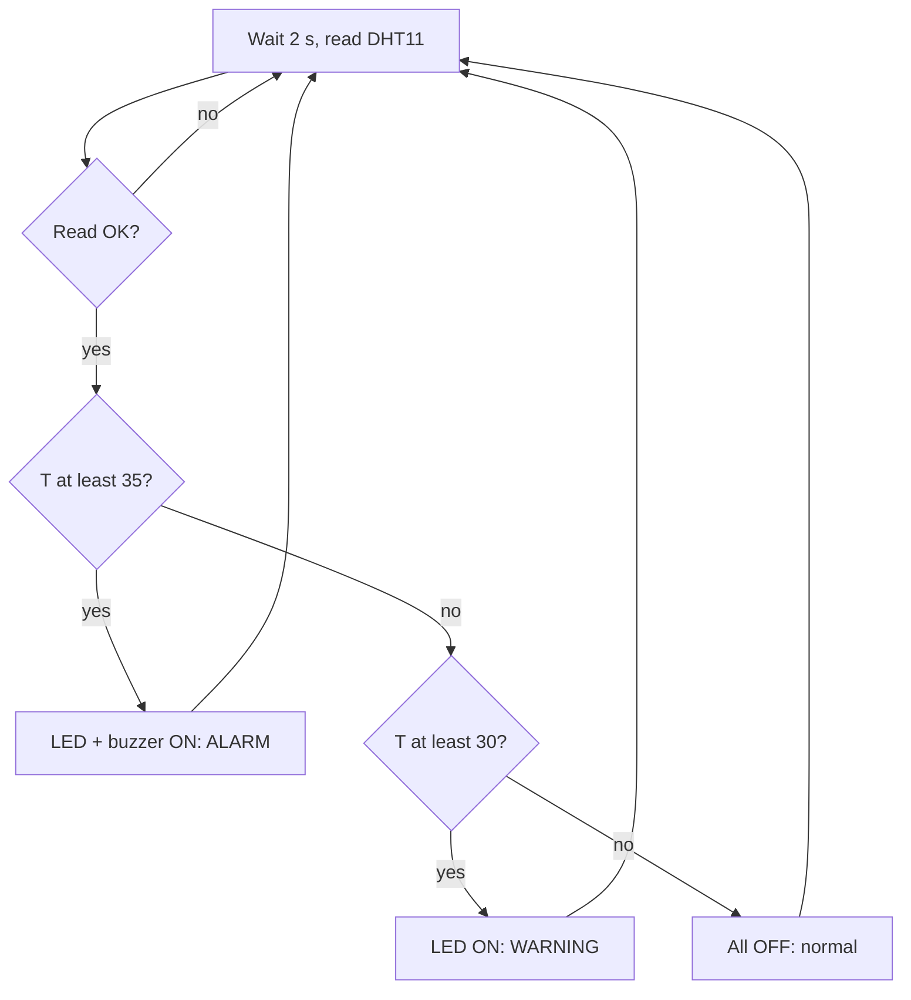

# Project 3 — Temperature Warning (DHT11 + LED + buzzer)

## Objective
Show a warning LED above 30 °C and sound a buzzer above 35 °C.

## Components
ESP32, DHT11 (module or bare + 10 kΩ pull-up), LED + 220 Ω, active buzzer, jumper wires.

## Circuit
| From | To |
|---|---|
| DHT11 VCC | 3V3 |
| DHT11 DATA | GPIO4 (+10 kΩ pull-up to 3V3 for bare sensor) |
| DHT11 GND | GND |
| LED | GPIO26 → 220 Ω → LED (+); (−) → GND |
| Buzzer (+) | GPIO25; (−) → GND |

Diagram: [DHT11 wiring](../../04_Sensors/DHT11/images/dht11_circuit.svg)

## Working
Every 2 seconds the ESP32 reads temperature and humidity through the DHT library, ignores failed readings, and compares the temperature with two limits.

## Algorithm


## Code (needs the Adafruit DHT libraries)
```cpp
// Project 3 - Temperature Warning (DHT11 + LED + buzzer)
// Wiring: DHT11 VCC->3V3, DATA->GPIO4, GND->GND (10k pull-up on bare sensors)
//         GPIO26 -> 220 ohm -> LED -> GND;  GPIO25 -> active buzzer (+)
// Library: "DHT sensor library" by Adafruit (+ "Adafruit Unified Sensor")

#include "DHT.h"

const int DHT_PIN = 4;
const int LED_PIN = 26;
const int BUZZER_PIN = 25;

const float WARNING_C = 30.0;    // LED ON above this
const float ALARM_C = 35.0;      // Buzzer ON above this

DHT dht(DHT_PIN, DHT11);

void setup()
{
  Serial.begin(115200);
  pinMode(LED_PIN, OUTPUT);
  pinMode(BUZZER_PIN, OUTPUT);
  dht.begin();
}

void loop()
{
  delay(2000);

  float temperature = dht.readTemperature();
  float humidity = dht.readHumidity();

  if (isnan(temperature) || isnan(humidity))
  {
    Serial.println("DHT11 read failed - check wiring");
    return;
  }

  Serial.print("Temp: ");
  Serial.print(temperature, 1);
  Serial.print(" C  Humidity: ");
  Serial.print(humidity, 0);
  Serial.print(" %  ");

  if (temperature >= ALARM_C)
  {
    digitalWrite(LED_PIN, HIGH);
    digitalWrite(BUZZER_PIN, HIGH);
    Serial.println("-> ALARM");
  }
  else if (temperature >= WARNING_C)
  {
    digitalWrite(LED_PIN, HIGH);
    digitalWrite(BUZZER_PIN, LOW);
    Serial.println("-> WARNING");
  }
  else
  {
    digitalWrite(LED_PIN, LOW);
    digitalWrite(BUZZER_PIN, LOW);
    Serial.println("-> normal");
  }
}
```

## Expected output
```
Temp: 27.0 C  Humidity: 60 %  -> normal
Temp: 31.0 C  Humidity: 66 %  -> WARNING
Temp: 36.0 C  Humidity: 70 %  -> ALARM
```
(To test safely, warm the sensor with your fingers or lower the limits in the code. Do not heat it with flames.)

## Possible improvements
- Show values on an I2C OLED display.
- Drive a real fan through a transistor/relay module (with an instructor).
- Log values to the Serial Plotter.
