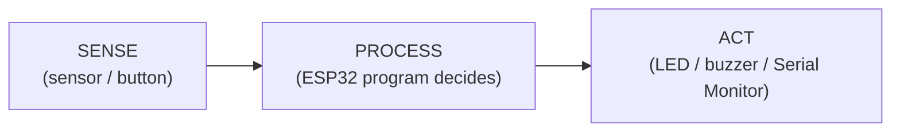
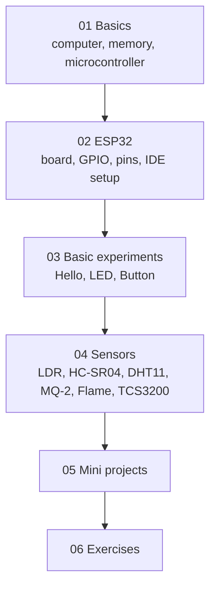

# ESP32 Beginner Hands-On Handbook

A beginner-friendly, hands-on handbook for students learning **microcontrollers** with a **physical ESP32 board** connected to a laptop over USB. 

> **Central idea of the whole handbook:** &nbsp; **SENSE → PROCESS → ACT**



---

## Learning objectives

After completing this handbook, a student will be able to:

1. Explain what a computer, program, firmware, microcontroller and embedded system are.
2. Explain the difference between RAM and Flash and where an ESP32 keeps its program.
3. Install Arduino IDE, add ESP32 support, upload a program and use the Serial Monitor.
4. Use GPIO pins as digital outputs, digital inputs and analog (ADC) inputs.
5. Wire and read six common sensors safely at 3.3 V logic.
6. Apply the workflow *observe raw readings → choose a threshold → control an output*.
7. Build and debug small SENSE → PROCESS → ACT projects.

## Hardware required

| Item | Quantity | Note |
|---|---|---|
| ESP32 DevKit, 38-pin (ESP32-WROOM-32) | 1 per student/group | The 30-pin version also works; check your pinout |
| USB cable (**data** cable, not charge-only) | 1 | Micro-USB or USB-C depending on board |
| Breadboard + jumper wires | 1 set | 38-pin boards are wide; two breadboards may help |
| LED (any colour) + 220 Ω resistor | 2 | |
| Push button | 1 | |
| Active buzzer (3.3 V/5 V type) | 1 | |
| LDR + 10 kΩ resistor | 1 | |
| HC-SR04 ultrasonic sensor | 1 | Needs 5 V power; ECHO needs level shifting |
| DHT11 (module or bare sensor) | 1 | Bare sensor needs 10 kΩ pull-up |
| MQ-2 gas/smoke sensor module | 1 | Needs warm-up; AO needs a divider |
| Flame sensor module | 1 | |
| TCS3200 colour sensor module | 1 | |
| Resistors: 1 kΩ, 2 kΩ, 10 kΩ, 20 kΩ | several | Voltage dividers |

## Software required

- **Arduino IDE 2.x** (free) – https://www.arduino.cc/en/software
- **ESP32 board support** by Espressif Systems (installed inside Arduino IDE)
- **USB driver** for your board's USB chip (CP210x or CH340) if Windows does not detect it
- DHT sensor library (Adafruit) – installed later in the DHT11 chapter

## Sensors covered

LDR · HC-SR04 ultrasonic · DHT11 · MQ-2 · Flame sensor · TCS3200 colour sensor

## Learning path



Workshop hands-on order:

1. *(Optional, 10–15 min)* Arduino/Tinkercad LED demo – concept only.
2. Laptop + physical ESP32 → Arduino IDE → Upload → Serial Monitor → LED → Button → LDR → HC-SR04 → DHT11 → MQ-2 → Flame → TCS3200.

## Folder structure

```
ESP32-Beginner-Handbook/
├── README.md
├── 01_Basics/                 software/program/IDE, microcontroller, micro vs MCU, memory
├── 02_ESP32/                  intro, GPIO, pin reference, Arduino IDE setup
├── 03_Basic_Experiments/      Hello_ESP32, LED_On_Off, LED_Blink, LED_Patterns,
│                              Push_Button, Button_LED (+ optional Tinkercad intro)
├── 04_Sensors/                LDR, HC_SR04, DHT11, MQ2, Flame_Sensor, TCS3200
│                              (each: README.md + .ino + images/)
├── 05_Mini_Projects/          5 complete projects
├── 06_Exercises/              Level 1-4 hands-on exercises
├── docs/                      table of contents, workflow, troubleshooting, cheat sheet,
│                              golden rule, sensor comparison, applications, workshop plan
├── images/                    shared SVG diagrams
└── LICENSE
```

**Start here:** [Table of Contents](docs/Table_of_Contents.md) · [Cheat Sheet](docs/Cheat_Sheet.md) · [Troubleshooting](docs/Troubleshooting.md) · [The Golden Rule](docs/Golden_Rule.md)

## How to use this repository

1. Read chapters in numeric order. Do not skip Part 1–2 even if you have used Arduino before.
2. Do every experiment on the **physical board**. Type the code yourself first, then compare with the `.ino` file.
3. For every experiment, answer: *What is happening physically? What signal is generated? How does the ESP32 receive it? What does the program do? What output do we get?*
4. Always check **voltage first**, then wire, then upload.

## Safety notes

- The ESP32 GPIO logic is **3.3 V**. **Never connect a 5 V signal directly to a GPIO** unless your exact board's documentation confirms it is safe.
- Disconnect USB before changing wiring.
- Never draw more than a few mA from a GPIO; use a resistor with every LED. Never power motors/relays directly from a GPIO.
- MQ-2 and flame-sensor projects are **educational prototypes, not certified safety devices**. Never rely on them to protect life or property.
- Do not test flame sensors with uncontrolled fire. Use a small candle/lighter only under instructor supervision, away from flammable items.
- The MQ-2 heater gets hot; do not touch it.

## Pin map used in this handbook (ESP32 DevKit 38-pin)

> **Always verify against your own board's pinout.** Silkscreen labels differ between brands.

| Item | GPIO |
|---|---|
| LED (+220 Ω) | 26 |
| Push button | 27 |
| Active buzzer | 25 |
| LDR divider midpoint | 34 |
| MQ-2 AO (through divider) | 35 |
| HC-SR04 TRIG / ECHO (ECHO through divider) | 18 / 19 |
| DHT11 DATA | 4 |
| Flame sensor DO / AO | 32 / 33 |
| TCS3200 S0, S1, S2, S3, OUT | 16, 17, 21, 22, 23 |

