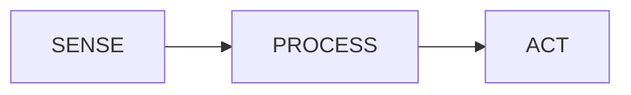

# THE GOLDEN RULE

# SENSE → PROCESS → ACT

Every embedded system, from a toy to a car, follows this rule:

1. **SENSE** — a sensor turns a physical quantity into an electrical signal.
2. **PROCESS** — the ESP32 reads the signal and the program **decides**.
3. **ACT** — the ESP32 drives an output that changes the real world.

## LDR → ESP32 → LED
- **SENSE:** LDR + divider give a voltage that follows the light level.
- **PROCESS:** ESP32 reads ADC value; `if (value < threshold)` → it is dark.
- **ACT:** LED turns ON.

## HC-SR04 → ESP32 → buzzer
- **SENSE:** ultrasonic echo pulse length = distance.
- **PROCESS:** ESP32 measures with `pulseIn()`, calculates centimetres, `if (distance < limit)`.
- **ACT:** buzzer beeps.

## DHT11 → ESP32 → warning LED
- **SENSE:** DHT11 sends digital temperature/humidity data.
- **PROCESS:** ESP32 reads via library; `if (temperature > limit)`.
- **ACT:** warning LED turns ON.

> Whenever you meet a new sensor, ask three questions: **What does it SENSE? How will the ESP32 PROCESS it? What will it ACT on?**
