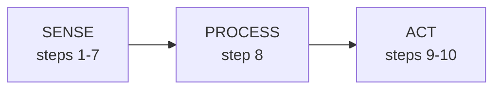
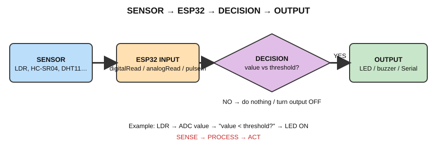

# Practical Workflow (use this for every sensor)

**Central concept: SENSE → PROCESS → ACT**



| Step | What to do | Why |
|---|---|---|
| **STEP 1** | Understand what the sensor detects | Know the physical quantity |
| **STEP 2** | Identify the sensor output type (analog, digital, pulse, protocol, frequency) | Chooses the reading method |
| **STEP 3** | Check voltage requirements (supply and output level) | Prevents damaging the ESP32 |
| **STEP 4** | Make the wiring (USB unplugged) | Correct circuit |
| **STEP 5** | Upload a simple test program | Verifies the circuit |
| **STEP 6** | Open the Serial Monitor (115200 baud) | See what the ESP32 sees |
| **STEP 7** | Observe raw readings | Learn the real values in your setup |
| **STEP 8** | Apply a threshold/decision | PROCESS |
| **STEP 9** | Control an output (LED / buzzer) | ACT |
| **STEP 10** | Build an application | Put it to use |

The hardware chain:

```
LAPTOP → USB → PHYSICAL ESP32 → SENSOR → ESP32 PROGRAM → SERIAL MONITOR / LED / BUZZER
```


